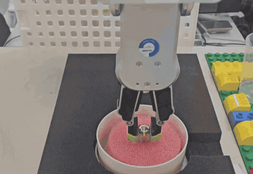
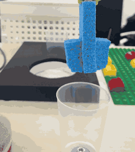
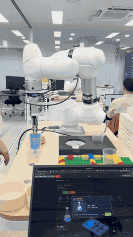
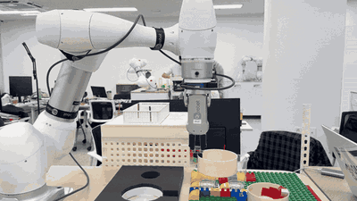

# 🙋 내 역할 — 박진용 (PreWash)

**F3 접촉 닦기 · 팀 공용 힘 함수 · 안전 담당**

세척 툴을 쥔 M0609가 그릇과 컵 안쪽을 일정한 힘으로 닦는 동작(`soap` · `wipe_bowl` · `wipe_cup`)과, 팀 전체가 쓰는 힘 · 순응 · 접촉 함수(`force.py`)를 만들었습니다. 닦는 도중 툴을 놓치면 그 자리에 멈추고 사람이 팔을 밀면 이어 가는 기능과, 로봇 위치를 모를 때 스스로 움직이지 않는 안전 처리도 만들었습니다.

**다룬 기술:** Doosan M0609 힘 · 순응 제어(`task_compliance_ctrl` · `set_desired_force`) · 비동기 모션(`amove_spiral` · `amove_periodic` · `movec`) · RG2 그립 폭 감시 · ROS 2 Jazzy · Python · pytest(가짜 두산 모듈)

**담당 코드:** `src/f3_wipe/f3_wipe/wipe.py` · `src/cobot_common/cobot_common/force.py`

---

## 1. 닦기 모듈 설계

카메라가 없어서 용기 높이를 알 수 없었고, 수세미가 물러 바닥에 닿는 깊이도 실행마다 12 ~ 17 mm로 달랐습니다. 그래서 바닥 높이는 정해 두지 않고 접촉 하강으로 찾습니다. 벽은 반대로 정해진 치수로 계산합니다. 그릇 안지름 110 mm와 수세미 지름 90 mm로 반지름을 정했습니다.

실패는 예외로 던지지 않고 결과 코드로 돌려줍니다. 흐름 노드는 실패 종류에 따라 재시도, 격리, 정지 중 하나로 대응해야 해서, F3 안에서 나는 예외를 전부 `OK`, `TOOL_LOST`, `FORCE_LIMIT`, `TIMEOUT`, `ROBOT_ERROR` 중 하나로 바꿉니다. 이 중 툴 놓침을 따로 구분하는 `TOOL_LOST`는 제가 제안해서 추가했습니다. 어떤 실패에서든 힘과 순응은 반드시 끄고, 위로 빠지는 건 위치를 알 때만 합니다.

F3는 노드가 아니라 함수 모음으로 만들었습니다. 로봇에 명령을 내는 곳이 여럿이면 명령이 겹칩니다. 그래서 메인 흐름 노드가 순서대로 부르는 함수로 두었고, 로봇은 공용 함수(`cobot_common`)로만 움직입니다.

---

## 2. 팀 공용 힘 함수 `force.py`

4명이 각자 두산 API를 직접 부르면 초기화 순서나 반환값, 오류 코드에서 같은 함정을 각자 밟게 됩니다. 그래서 힘, 순응, 접촉, 닦기 이동을 한 파일로 모으고 두산 함수 이름 대신 하는 일이 드러나는 이름으로 감쌌습니다. 팀원은 두산 API를 몰라도 이 함수들만 쓰면 됩니다.

| 공용 함수 | 두산 API | 하는 일 |
|---|---|---|
| `force_on(axis, target, limit)` | `task_compliance_ctrl` → `set_desired_force` | 순응 ON → 목표 힘 ON |
| `force_off()` | `release_force` → `release_compliance_ctrl` | 힘 해제 → 순응 해제 |
| `force_release()` | `release_force` | 힘만 끄고 순응 유지 |
| `contact_down(max_depth, limit)` | `movel` 반복 + `get_tool_force` | 순응을 켠 채 3 mm씩 내려가며 Z 힘 감시 → (깊이, 힘) |
| `move_spiral` · `move_arc` · `move_periodic` | `amove_spiral` · `movec` · `amove_periodic` | 닦기 이동 |
| `safe_retreat()` | `release_force` · `movel` | 힘 · 순응 끄고 Z만 안전 높이로 |
| `start_nudge_watch` · `check_nudge` | `get_tool_force` | 멈춘 자리 힘 기준 → 팔 밀기 감지 |

### 호출 순서와 함정

호출 순서와 알고 있는 함정은 함수 안에 넣었습니다. 비동기 이동 중에 순응을 켜면 오류(2.1903)가 나서, `force_on`은 먼저 `mwait`로 이동이 끝나기를 기다립니다. 힘 제어는 순응이 켜져 있어야 동작하니 순응을 켠 다음 힘을 켜는 순서로 고정했습니다. `target < limit ≤ force_max`를 어기면 명령을 보내기 전에 `ValueError`로 거부하고, 힘 설정이 실패하면 앞서 켜 둔 순응까지 되돌립니다.

`force_off`는 힘 해제가 실패해도 순응 해제까지 시도한 뒤에 예외를 올립니다. 중간에 멈추면 `safe_retreat`가 막힙니다. 설정값이 비어 있으면 로봇을 움직이지 않고, 어떤 키가 비었는지 `KeyError`로 알려 줍니다.

### 접촉 판정

수세미와 솔은 툴 무게에 등록되어 있지 않아서 공중에서도 Fz가 1.9 ~ 2.3 N 잡힙니다. 그래서 접촉은 절대값이 아니라 **시작 대비 변화량**으로 판정합니다. 하강 시작 전 힘을 기준으로 잡고 "얼마나 더 눌렸는가"만 봅니다.

실기 없이 시험할 수 있도록 가짜 두산 모듈을 만들어, 호출 순서와 판정, 예외, 설정 누락을 pytest로 확인합니다.

```python
# contact_down — 3 mm씩 내려가며 시작 대비 변화량으로 접촉 판정
f0 = read_force()[2]
while True:
    depth = z0 - _current_z(d)
    f = abs(read_force()[2] - f0)          # 시작 대비 변화량(누르는 힘)
    if f > f_max:
        raise ForceLimitError(f'contact_down: 누르는 힘 {f:.1f} N > {f_max} N')
    if f >= limit or depth >= max_depth:
        return depth, f
    move_rel(0.0, 0.0, -min(step, max_depth - depth), 'BASE', vel_mm_s=vel, acc_mm_s2=acc)
```

---

## 3. 그릇 닦기 `wipe_bowl()`

<p align="center"></p>

### 바닥 찾기

먼저 140 mm를 빠르게 내려간 뒤, 공중에서 힘 기준값을 5번 재서 평균합니다. 이때 이미 3 N을 넘으면 툴이나 접촉에 이상이 있다고 보고 멈춥니다. 그다음 순응을 켠 채 3 mm씩 최대 30 mm까지 내려가다가 시작 대비 3 N이 되면 멈춥니다. 순응은 그대로 두고, 0.05 mm 넘게 밀렸을 때만 접촉 높이로 보정합니다.

### 바닥 나선

바닥은 `amove_spiral` 한 동작으로 빠짐없이 훑습니다. 반지름 14 mm, 피치 5 mm(약 2.8바퀴), 2.0 s로 돕니다. 이 구간에서는 순응만 켭니다. 나선은 힘 방향(Z)과 이동 방향이 같아서, 힘 제어를 켜면 그 힘이 이동 자체를 막아 버립니다.

Move Spiral은 [시간] 옵션 전용이라 `vel`과 `acc`는 0으로 두고 `time`만 넘깁니다. 도는 동안 실제 반지름을 확인하다가 목표의 절반도 못 가면 오류로 멈춥니다.

### 벽 원호

벽은 `movec` 원호에 좌우 비틀기를 더해 닦습니다. 반지름은 (110 − 90) / 2 + 누르는 여유 4 = 14 mm로 고정했습니다. 벽은 눌러야 닦이고, 원호는 이동 방향과 힘 방향이 달라 서로 방해하지 않습니다. 그래서 여기서는 순응과 힘 제어를 같이 켭니다(목표 1.5 N, 상한 10 N, 옆 힘 25 N). 목표 힘을 높이면 무른 수세미가 파고들면서 작업대를 칩니다. 목표는 1.5 N으로 두고 높이는 명령하지 않습니다.

원호 90° × 3바퀴는 blend radius로 이어 붙여 끊김 없이 돕니다. 도는 중에는 위치를 읽지 않는데, 걸음마다 읽으면 서비스 왕복 동안 로봇이 매번 서기 때문입니다. 비틀기 ±10°도 따로 명령하지 않습니다. 원호 끝 자세의 회전 성분(rz)에 얹고 원호마다 부호를 바꿔서, 한 명령으로 돌면서 비틀게 했습니다.

다 돌고 나면 `force_release`로 힘만 끄고 순응은 유지한 채 중심으로 돌아옵니다. 그 뒤 순응까지 끄고 호출된 높이로 올라옵니다.

```python
# 원호마다 끝 자세 rz 에 비틀기를 얹고 부호를 바꾼다
def pose(th, rz):
    return [x0 + r_wall * math.cos(th), y0 + r_wall * math.sin(th), z_now,
            a, b, (c + rz + 180.0) % 360.0 - 180.0]

cc.move_arc(pose(th_mid, rz_mid), pose(th_end, tw * twist), lin_v, rot_v,
            0.0 if k == n - 1 else radius, lin_a, rot_a)
```

---

## 4. 컵 닦기 `wipe_cup()`

<p align="center"></p>

컵은 깊고 솔이 단단해서 높이가 조금만 어긋나도 바로 박힙니다. 그래서 바닥은 힘으로만 찾습니다. 120 mm를 빠르게 내려간 뒤 접촉 하강으로 찾고, 최대 깊이는 40 mm, 판정 힘은 컵 전용 5 N입니다.

컵 안은 좁고 깊어서 나선이나 원호로는 훑을 수 없습니다. 대신 가장 낮은 자리에서 위아래 ±15 mm와 6번 관절 ±90°를 `amove_periodic` 한 명령으로 동시에 왕복합니다(주기 2.6 s × 5회). 솔이 단단해 눌러 닦는 방식은 맞지 않아서 순응과 힘 제어는 끄고, 상한(10 N, 옆 힘 25 N)만 감시합니다.

회전은 TOOL rz만 씁니다. 실기에서 TOOL rz는 6번 관절을, rx는 4번 관절을 돌립니다. Virtual은 rx와 rz를 뒤바꿔 움직이기 때문에 이 축은 Virtual 결과를 믿지 않습니다. 도는 동안에는 1번과 4번 관절을 0.05 s마다 확인하고, 1.0°를 넘으면 즉시 정지(QSTOP)합니다. 그런 다음 힘을 끄고 호출 높이로 곧게 올라온 뒤 `ROBOT_ERROR`를 돌려줘서 사람이 자세를 확인하게 합니다.

회전에 다른 축 이동이 섞이면 6번 관절이 한계를 넘어도 두산 제어기가 걸러내지 못합니다. 그래서 명령 전에 `2π × 진폭 ÷ 주기`로 최고 속도(217.5 °/s)를 계산하고, 로봇 한계 225 °/s를 넘으면 막습니다.

```python
# 1 · 4번 관절이 1° 넘게 움직이면 즉시 정지
q = cc.joints()
bad = [(k + 1, q[k] - q0[k]) for k in (0, 3) if abs(q[k] - q0[k]) > guard]
if bad:
    cc.stop_now()
    raise JointGuardStop('wipe_cup: ' + ' · '.join(f'{k} 번 조인트 {d:+.1f}°' for k, d in bad))
```

---

## 5. 세제 담금 `soap()`

그릇용과 컵용 툴은 위치가 다릅니다. 그래서 지금 잡은 위치의 BASE X 좌표(349 mm 기준)로 어느 쪽인지 판별하고, 다음 작업 위치도 거기에 맞춰 다르게 보냅니다.

세제는 그 자리에서 손목 ±20° 비틀기(3회)와 Z ±5 mm 왕복(2회)을 `amove_periodic`으로 해서 묻힙니다. 담금통 안은 자유 공간이라 접촉 제어가 필요 없어서 순응과 힘 제어는 쓰지 않습니다. 비틀기도 명령 전에 최고 속도(126 °/s)를 계산하고, 로봇 한계 225 °/s를 넘으면 막습니다.

---

## 6. 툴 놓침 감시 · 팔 밀어 재개

<table>
  <tr>
    <td width="50%" align="center"><br><sub>툴 놓침 → 멈춤 → 툴을 다시 꽂고 팔을 밀어 재개</sub></td>
    <td width="50%" align="center"><br><sub>멈춘 팔을 가볍게 밀면 이어 감</sub></td>
  </tr>
</table>

### 놓침 감시

닦는 도중 툴을 놓쳐도 로봇은 그걸 알지 못합니다. 그래서 세 함수 모두 시작할 때 그립 폭을 기준으로 기록해 두고, 동작 중에 계속 비교합니다. 허용오차는 1.0 mm입니다. 놓치면 폭이 2 ~ 3 mm 변하고 정상 흔들림은 0.1 ~ 0.2 mm라서 둘은 확실히 갈립니다.

문제는 상대 이동(`move_rel`)이었습니다. 이 함수는 끝날 때까지 돌아오지 않아서 도중에 검사할 틈이 없습니다. 그래서 별도 스레드가 20 ms마다 폭을 보다가, 놓치면 `halt`로 이동을 끊고 `ToolLostError`로 바꿔 올리게 했습니다.

`TOOL_LOST`일 때는 후퇴하지 않고 그 자리에 멈춰서 놓친 자리를 그대로 보존합니다. 세 함수에 공통인 놓침 처리는 공용 함수 4개(`_set_baseline`, `_on_tool_lost`, `_finish_guard`, `_finish_rise`)로 묶었습니다.

### 팔 밀어 재개

사람이 툴을 다시 꽂은 뒤 화면까지 가지 않고도 이어 갈 수 있게 했습니다. 멈춘 자리의 힘을 기준으로 잡아 두고, 변화량이 임계값을 넘은 상태가 일정 시간 유지되면 재개 신호를 냅니다.

재개하면 처음 집었던 정확한 좌표로 곧장 다시 내려가 툴을 잡고, 놓쳤던 단계부터 이어 갑니다. 관절 이동으로 가지 않는 이유는 보호 정지 뒤에는 자세가 애매해서 도착 실패가 반복되기 때문입니다.

```python
def watch():
    while not stop_watch.is_set():
        if _tool_lost_now():
            lost['via_halt'] = True
            cc.halt()                # 놓친 순간 이동을 끊는다
            return
        time.sleep(0.02)             # 20 ms 주기
```

---

## 7. 안전

도착 확인 실패나 정지처럼 로봇 위치를 모르는 경우에는 힘과 순응만 끄고, 로봇은 움직이지 않은 채 사람에게 넘깁니다. 힘과 순응을 끄는 건 모션이 아니라서 이 경우에도 끕니다. 반면 힘 상한 초과는 로봇 자체는 정상이라는 뜻이라 설계대로 후퇴합니다. 두 경우를 구분해서 처리하고, 시험으로 확인합니다.

---

## 8. 트러블슈팅

### ① 접촉 하강이 공중을 바닥으로 오판 — 시작 대비 변화량으로 판정

그릇 바닥을 찾는 첫 실기에서 0.1 mm 내려가자마자 "바닥에 닿았다"고 판정했습니다. 절대 힘이 임계값을 넘으면 접촉으로 보고 있었는데, 수세미와 솔이 툴 무게에 등록되지 않아 공중에서도 Fz가 약 2 N 잡히고 있었습니다. 툴이 가벼워서 무게 등록으로도 해결되지 않았습니다. 그래서 하강 시작 전 힘을 기준으로 변화량만 보도록 바꿨습니다.

### ② 나선을 속도로 부르니 드라이버 전체가 멈춤 — 시간 지정으로 고정

`amove_spiral`을 다른 이동처럼 `vel` 인자를 채워 불렀더니 로봇 드라이버 자체가 멈춰서 브링업부터 다시 켜야 했습니다. 매뉴얼을 보니 Move Spiral은 [속도]가 아니라 [시간] 옵션으로 지정하는 명령이었습니다. 그렇다고 `vel`을 빼면 파이썬 API가 거부합니다. 결국 `vel`과 `acc`는 0, `time`만 넘기도록 고정했습니다.

```python
d.amove_spiral(rev=..., rmax=..., lmax=0.0, vel=[0.0, 0.0], acc=[0.0, 0.0],
               time=float(time_s), axis=axis_c, ref=ref_c)
```

### ③ 나선이 반환은 정상인데 시작하지 않음 — 회전 수 조정

반지름 14 mm, 7바퀴, 3 s로 주면 반환값은 정상인데 실제로는 돌지 않았습니다. 실제 반지름은 0.3 mm에 그쳤습니다. 반지름에 비해 회전 수와 시간이 과하면 속도 오류로 시작하지 않는 것이었습니다. 피치를 5 mm로 넓혀 2.8바퀴로 줄였고, 도는 동안 실제 반지름을 보다가 목표의 절반도 못 가면 오류로 멈추게 했습니다.

### ④ 벽을 힘으로 찾을 수 없음 — 치수로 반지름 고정

처음에는 그릇 크기를 모르는 상태에서 반지름 방향 힘으로 벽을 찾으려 했습니다. 그런데 벽은 한쪽에서만 찾혔고, 그 위치도 계산값 27.5 mm와 다른 35 mm였습니다.

바닥 마찰이 안쪽으로 걸려서 벽과 방향이 같았고, 크기도 마찰 5.1 N, 벽 5.7 N으로 겹쳤습니다. 판정 기준을 "명령을 못 따라간 거리"로 바꿔 봤지만, 수세미가 로봇 순응보다 훨씬 물러서 그 거리가 생기지 않았습니다. 바닥 마찰 5 ~ 14 N이 벽 신호 1 ~ 2 N을 덮어 버린 겁니다.

그래서 벽 찾기는 버리고, 그릇 안지름과 수세미 지름으로 반지름을 14 mm로 고정했습니다.

### ⑤ TOOL rz가 Virtual과 실기에서 다른 관절을 돌림 — TOOL rz만 쓰고 관절 감시

같은 회전 명령이 Virtual에서는 그리퍼 축(6번 관절)을, 실기에서는 4번 관절을 돌렸습니다. rx로는 실기에서 부딪힐 뻔하기도 했습니다. TCP 설정에 따라 TOOL 회전 채널이 대응하는 관절이 달라지고, Virtual은 rx와 rz를 뒤바꿔 움직였던 겁니다. 그래서 컵 닦기는 TOOL rz만 쓰고, 도는 동안 1번과 4번 관절을 감시해서 1.0°를 넘으면 즉시 정지하게 했습니다.

### ⑥ 컵 회전 속도가 알람 없이 한계 초과 — 명령 전 속도 검사

컵 동작에 옆 진폭(8 mm)을 실험으로 얹었더니, 6번 관절이 정격 225 °/s의 145 %인 326.5 °/s로 돌았는데도 알람이 없었습니다. 회전에 다른 축 이동을 섞으면 역기구학상 6번 관절이 훨씬 빨리 돌아야 하는데, 두산 제어기 자체 검사(알람 1212)도 이 조합은 걸러내지 못했습니다. 옆 진폭 실험은 위험해서 버렸고, 대신 명령 전에 최고 속도를 계산해 한계를 넘으면 막는 검사를 넣었습니다.

### ⑦ 툴 놓침을 감지한 뒤에도 빈 그리퍼로 한 번 더 움직임 — 그 자리에서 정지

놓침을 감지해 멈췄는데도, 실기 로그에 빈 그리퍼로 한 번 더 이동한 기록이 남아 있었습니다. 정리 단계의 "실패하면 안전한 자리로 후퇴" 로직을 놓침도 그대로 타고 있었습니다. `TOOL_LOST`면 후퇴하지 않고 그 자리에 멈추도록 고쳤고, 이 일을 계기로 팔 밀어 재개와 다시 집기 기능을 만들었습니다.

### ⑧ 두산 인자 오류로 ROS가 꺼져 순응이 켜진 채 남음 — 복구 도구

두산 함수에 잘못된 인자를 넘기면 `DR_Error`가 나면서 그 프로세스의 `rclpy.shutdown()`이 불렸습니다. 이러면 정리 단계의 `force_off`도 전달되지 않아 순응이 켜진 채로 남습니다. 그래서 새 프로세스에서 남은 힘과 순응을 끄는 복구 도구(`release_force.py`)와 복구 절차 문서를 만들었습니다.

### ⑨ 로봇 위치를 모르는데 자동으로 HOME으로 가려 함 — 자동 이동 금지

6번 관절이 163° 돌아 그리퍼 케이블이 꼬인 채 로봇이 멈췄는데, 그 상태에서 자동으로 HOME으로 가려 했습니다. 꼬인 채 움직이면 더 꼬이거나 부딪힙니다. 그래서 닦기 코드에서 위치를 모르는 경우(도착 확인 실패, 정지)에는 힘과 순응만 끄고 움직이지 않게 했습니다. 힘 상한 초과는 그대로 후퇴하도록 따로 구분했습니다.
