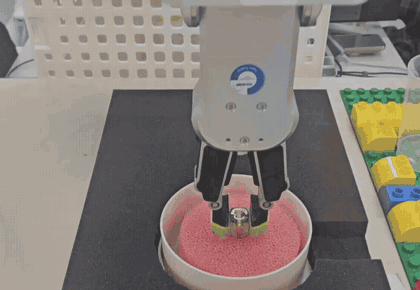

# 🙋 내 역할 — 박진용 (PreWash)

**F3 접촉 닦기 · 팀 공용 힘 함수 · 안전 담당**

세척 툴을 쥔 M0609가 그릇과 컵 안쪽을 일정한 힘으로 닦는 동작(`soap` · `wipe_bowl` · `wipe_cup`)과, 팀 전체가 쓰는 힘 · 순응 · 접촉 함수(`force.py`)를 만들었습니다. 닦는 도중 툴을 놓치면 그 자리에 멈추고 사람이 팔을 밀면 이어 가는 기능과, 로봇 위치를 모를 때 스스로 움직이지 않는 안전 처리도 만들었습니다.

**다룬 기술:** Doosan M0609 힘 · 순응 제어(`task_compliance_ctrl` · `set_desired_force`) · 비동기 모션(`amove_spiral` · `amove_periodic` · `movec`) · RG2 그립 폭 감시 · ROS 2 Jazzy · Python · pytest(가짜 두산 모듈)

**담당 코드:** `src/f3_wipe/f3_wipe/wipe.py` · `src/cobot_common/cobot_common/force.py`

---

## 1. 닦기 모듈 설계

- **바닥은 힘으로, 벽은 치수로**
  - 카메라가 없어 용기 높이를 모르고, 수세미가 물러 바닥에 닿는 깊이가 실행마다 12 ~ 17 mm로 다릅니다. → 높이를 정해 두지 않고 접촉 하강으로 바닥을 찾습니다.
  - 벽은 정해진 치수로 계산합니다. 그릇 안지름 110 mm와 수세미 지름 90 mm로 반지름을 정합니다.
- **실패는 예외가 아니라 결과 코드로**
  - 흐름 노드가 실패 종류마다 다르게 대응(재시도 · 격리 · 정지)해야 합니다.
  - → F3 안에서 나는 예외를 전부 `OK` · `TOOL_LOST` · `FORCE_LIMIT` · `TIMEOUT` · `ROBOT_ERROR` 코드로 바꿔 돌려줍니다. 툴 놓침을 따로 구분하는 `TOOL_LOST`는 직접 제안해 추가했습니다.
  - 어떤 실패에서도 힘 · 순응은 반드시 끄고, 위치를 아는 경우에만 위로 빠집니다.
- **노드가 아닌 함수 모음**
  - 로봇에 명령을 내는 곳이 하나여야 명령이 겹치지 않습니다.
  - → 메인 흐름 노드가 순서대로 부르는 함수로 만들고, 로봇은 공용 함수(`cobot_common`)로만 움직입니다.

---

## 2. 팀 공용 힘 함수 `force.py`

- **두산 API를 몰라도 쓰는 공용 함수**
  - 4명이 각자 두산 API를 직접 부르면 초기화 순서 · 반환값 · 오류 코드 함정을 각자 밟습니다.
  - → 힘 · 순응 · 접촉 · 닦기 이동을 한 파일로 모으고, 두산 이름 대신 하는 일이 드러나는 이름으로 감쌌습니다.

| 공용 함수 | 두산 API | 하는 일 |
|---|---|---|
| `force_on(axis, target, limit)` | `task_compliance_ctrl` → `set_desired_force` | 순응 ON → 목표 힘 ON |
| `force_off()` | `release_force` → `release_compliance_ctrl` | 힘 해제 → 순응 해제 |
| `force_release()` | `release_force` | 힘만 끄고 순응 유지 |
| `contact_down(max_depth, limit)` | `movel` 반복 + `get_tool_force` | 순응을 켠 채 3 mm씩 내려가며 Z 힘 감시 → (깊이, 힘) |
| `move_spiral` · `move_arc` · `move_periodic` | `amove_spiral` · `movec` · `amove_periodic` | 닦기 이동 |
| `safe_retreat()` | `release_force` · `movel` | 힘 · 순응 끄고 Z만 안전 높이로 |
| `start_nudge_watch` · `check_nudge` | `get_tool_force` | 멈춘 자리 힘 기준 → 팔 밀기 감지 |

- **호출 순서와 함정을 함수 안에 넣음**
  - 비동기 이동 중에 순응을 켜면 오류(2.1903)가 납니다. → `force_on`은 먼저 `mwait`로 이동이 끝나기를 기다립니다.
  - 힘 제어는 순응이 켜져 있어야 합니다. → 순응 → 힘 순서를 고정합니다.
  - `target < limit ≤ force_max`를 어기면 명령을 보내기 전에 거부(`ValueError`)하고, 힘 설정이 실패하면 켜 둔 순응까지 되돌립니다.
  - `force_off`는 힘 해제가 실패해도 순응 해제까지 시도한 뒤 예외를 올립니다. 그래야 `safe_retreat`가 막히지 않습니다.
  - 설정값이 비어 있으면 로봇을 움직이지 않고, 어떤 키가 비었는지 `KeyError`로 알립니다.
- **접촉 판정은 시작 대비 변화량**
  - 수세미 · 솔은 툴 무게에 등록되지 않아 공중에서도 Fz가 1.9 ~ 2.3 N 잡힙니다.
  - → 하강 시작 전 힘을 기준으로 잡고 "얼마나 더 눌렸는가"만 봅니다.
- **실기 없이 시험:** 가짜 두산 모듈로 호출 순서 · 판정 · 예외 · 설정 누락을 시험합니다(pytest).

```python
# contact_down — 3 mm씩 내려가며 시작 대비 변화량으로 접촉 판정
f0 = read_force()[2]
while True:
    depth = z0 - _current_z(d)
    f = abs(read_force()[2] - f0)          # 시작 대비 변화량(누르는 힘)
    if f > f_max:
        raise ForceLimitError(f'contact_down: 누르는 힘 {f:.1f} N > {f_max} N')
    if f >= limit or depth >= max_depth:
        return depth, f
    move_rel(0.0, 0.0, -min(step, max_depth - depth), 'BASE', vel_mm_s=vel, acc_mm_s2=acc)
```

---

## 3. 그릇 닦기 `wipe_bowl()`

<p align="center"></p>

- **바닥 찾기**
  - 140 mm 빠르게 내려간 뒤 공중 힘 기준값을 5번 평균합니다. 공중에서 이미 3 N을 넘으면 툴 · 접촉 이상으로 보고 멈춥니다.
  - 순응을 켠 채 3 mm씩 최대 30 mm 내려가며, 시작 대비 3 N에서 멈춥니다.
  - 순응은 그대로 유지하고, 0.05 mm 넘게 밀렸을 때만 접촉 높이로 보정합니다.
- **바닥 나선 `amove_spiral`**
  - 바닥 전체를 한 동작으로 빠짐없이 훑습니다. 반지름 14 mm · 피치 5 mm(약 2.8바퀴) · 2.0 s입니다.
  - **순응만 켬:** 나선은 힘 방향(Z)과 이동 방향이 같아, 힘 제어를 켜면 그 힘이 이동 자체를 막습니다.
  - **시간으로만 지정:** Move Spiral은 [시간] 옵션 전용이라 `vel`·`acc`는 0, `time`만 넘깁니다.
  - 도는 동안 실제 반지름을 보고, 목표의 절반도 못 가면 오류로 멈춥니다.
- **벽 원호 `movec` + 좌우 비틀기**
  - 반지름은 **(110 − 90) / 2 + 누르는 여유 4 = 14 mm**로 고정합니다.
  - 벽은 눌러야 닦이고, 원호는 이동 방향과 힘 방향이 달라 서로 방해하지 않습니다. → 순응 + 힘 제어를 같이 켭니다(목표 1.5 N · 상한 10 N · 옆 힘 25 N).
  - 목표 힘을 높이면 무른 수세미가 파고들어 작업대를 칩니다. → 목표는 1.5 N, 높이는 명령하지 않습니다.
  - 원호 90° × 3바퀴를 blend radius로 이어 붙여 끊김 없이 돌고, 도는 중에는 위치를 읽지 않습니다. 걸음마다 읽으면 서비스 왕복 동안 로봇이 매번 섭니다.
  - 비틀기 ±10°는 별도 명령이 아니라 **원호 끝 자세의 회전 성분(rz)에 얹어** 원호마다 부호를 바꿉니다. 한 명령으로 돌면서 비틉니다.
- **중심 복귀:** `force_release`로 힘만 끄고 순응은 유지한 채 중심으로 돌아온 뒤, 순응까지 끄고 호출된 높이로 올라옵니다.

```python
# 원호마다 끝 자세 rz 에 비틀기를 얹고 부호를 바꾼다
def pose(th, rz):
    return [x0 + r_wall * math.cos(th), y0 + r_wall * math.sin(th), z_now,
            a, b, (c + rz + 180.0) % 360.0 - 180.0]

cc.move_arc(pose(th_mid, rz_mid), pose(th_end, tw * twist), lin_v, rot_v,
            0.0 if k == n - 1 else radius, lin_a, rot_a)
```

---

## 4. 컵 닦기 `wipe_cup()`

<p align="center"></p>

- **바닥은 힘으로만**
  - 컵은 깊고 솔이 단단해, 높이가 조금만 어긋나도 바로 박힙니다.
  - → 120 mm 빠르게 내려간 뒤 접촉 하강으로만 찾습니다(최대 40 mm · 컵 전용 5 N).
- **위아래 + 손목 회전을 한 명령으로**
  - 좁고 깊어 나선 · 원호로 훑을 수 없습니다.
  - → 가장 낮은 자리에서 위아래 ±15 mm와 6번 관절 ±90°를 `amove_periodic` 한 명령으로 동시 왕복합니다(주기 2.6 s × 5회).
- **순응 · 힘 제어 끔**
  - 솔이 단단해 눌러 닦는 방식이 맞지 않습니다.
  - → 순응 · 힘 제어는 끄고 상한(10 N · 옆 힘 25 N)만 감시합니다.
- **회전은 TOOL rz만, 1 · 4번 관절 감시**
  - 실기에서 TOOL rz는 6번 관절, rx는 4번 관절을 돌립니다. Virtual은 rx와 rz를 뒤바꿔 움직여서, 이 축은 Virtual 결과를 믿지 않습니다.
  - 도는 동안 1 · 4번 관절을 0.05 s마다 확인해, 1.0°를 넘으면 즉시 정지(QSTOP)합니다. 힘을 끄고 호출 높이로 곧게 올라온 뒤 `ROBOT_ERROR`로 사람이 자세를 확인하게 합니다.
- **회전 속도 사전 검사**
  - 회전에 다른 축 이동이 섞이면 6번 관절이 한계를 넘어도 두산 제어기가 걸러내지 못합니다.
  - → 명령 전에 `2π × 진폭 ÷ 주기`로 최고 속도(217.5 °/s)를 계산해, 로봇 한계 225 °/s를 넘으면 막습니다.

```python
# 1 · 4번 관절이 1° 넘게 움직이면 즉시 정지
q = cc.joints()
bad = [(k + 1, q[k] - q0[k]) for k in (0, 3) if abs(q[k] - q0[k]) > guard]
if bad:
    cc.stop_now()
    raise JointGuardStop('wipe_cup: ' + ' · '.join(f'{k} 번 조인트 {d:+.1f}°' for k, d in bad))
```

---

## 5. 세제 담금 `soap()`

- **그릇 · 컵 자동 판별:** 그릇용과 컵용 툴 위치가 다릅니다. → 지금 잡은 위치의 BASE X 좌표(349 mm 기준)로 판별하고, 다음 작업 위치도 다르게 보냅니다.
- **비틀기 + 왕복:** 그 자리에서 손목 ±20° 비틀기(3회)와 Z ±5 mm 왕복(2회)으로 세제를 묻힙니다(`amove_periodic`).
- **순응 · 힘 제어 없음:** 담금통 안 자유 공간 동작이라 접촉 제어가 필요 없습니다.
- **비틀기 속도 사전 검사:** 명령 전에 최고 속도(126 °/s)를 계산해, 로봇 한계 225 °/s를 넘으면 막습니다.

---

## 6. 툴 놓침 감시 · 팔 밀어 재개

<table>
  <tr>
    <td width="50%" align="center"><br><sub>툴 놓침 → 멈춤 → 툴을 다시 꽂고 팔을 밀어 재개</sub></td>
    <td width="50%" align="center"><br><sub>멈춘 팔을 가볍게 밀면 이어 감</sub></td>
  </tr>
</table>

- **놓침 감시**
  - 닦는 도중 툴을 놓쳐도 로봇은 모릅니다.
  - → 세 함수 모두 시작할 때 그립 폭을 기준으로 기록하고, 동작 중 계속 비교합니다(허용오차 1.0 mm). 놓치면 폭이 2 ~ 3 mm 변하고, 정상 흔들림은 0.1 ~ 0.2 mm라 확실히 갈립니다.
- **움직이는 도중에도 감시**
  - 상대 이동(`move_rel`)은 끝날 때까지 돌아오지 않아 도중에 검사할 틈이 없습니다.
  - → 별도 스레드가 20 ms마다 폭을 보다가, 놓치면 `halt`로 끊고 `ToolLostError`로 바꿔 올립니다.
- **놓친 자리에서 그대로 정지**
  - `TOOL_LOST`면 후퇴하지 않고 그 자리에 멈춰 놓친 자리를 보존합니다.
  - 세 함수의 놓침 처리는 공용 함수 4개(`_set_baseline` · `_on_tool_lost` · `_finish_guard` · `_finish_rise`)로 묶었습니다.
- **팔 밀어 재개**
  - 사람이 툴을 다시 꽂은 뒤 화면까지 가지 않고 이어 가게 했습니다.
  - → 멈춘 자리 힘을 기준으로 잡고, 변화량이 임계값을 일정 시간 넘게 유지되면 재개 신호를 냅니다.
- **다시 집기**
  - 처음 집었던 정확한 좌표로 곧장 다시 내려가 잡고, 놓쳤던 단계부터 이어 갑니다.
  - 관절 이동으로 가면 보호 정지 뒤 자세가 애매해 도착 실패가 반복되기 때문입니다.

```python
def watch():
    while not stop_watch.is_set():
        if _tool_lost_now():
            lost['via_halt'] = True
            cc.halt()                # 놓친 순간 이동을 끊는다
            return
        time.sleep(0.02)             # 20 ms 주기
```

---

## 7. 안전

- **위치를 모르면 자동 이동 금지**
  - 도착 확인 실패 · 정지처럼 로봇 위치를 모르는 경우, 힘 · 순응만 끄고(모션이 아니므로), 로봇은 움직이지 않은 채 사람에게 넘깁니다.
  - 힘 상한 초과는 로봇이 정상이라는 뜻이라 설계대로 후퇴합니다. 두 경우를 구분해 처리하고 시험으로 확인합니다.

---

## 8. 트러블슈팅

**① 접촉 하강이 공중을 바닥으로 오판 → 시작 대비 변화량 판정**
- **문제:** 그릇 바닥을 찾는 첫 실기에서 0.1 mm 내려가자마자 "바닥에 닿았다"고 판정했습니다.
- **원인:** 절대 힘이 임계값을 넘으면 접촉으로 봤는데, 수세미 · 솔이 툴 무게에 등록되지 않아 공중에서도 Fz가 약 2 N 잡혔습니다. 툴이 가벼워 무게 등록으로도 해결할 수 없었습니다.
- **해결:** 하강 시작 전 힘을 기준으로 변화량만 보게 바꿨습니다.

**② 나선을 속도로 부르니 드라이버 전체가 멈춤 → 시간 지정 전용**
- **문제:** `amove_spiral`을 다른 이동처럼 `vel` 인자를 채워 불렀더니, 로봇 드라이버 자체가 멈춰 브링업부터 다시 켜야 했습니다.
- **원인:** 매뉴얼상 Move Spiral은 [속도]가 아니라 [시간] 옵션으로 지정하는 명령입니다. 그렇다고 `vel`을 빼면 파이썬 API가 거부합니다.
- **해결:** `vel` · `acc`는 0, `time`만 넘기도록 고정했습니다.

```python
d.amove_spiral(rev=..., rmax=..., lmax=0.0, vel=[0.0, 0.0], acc=[0.0, 0.0],
               time=float(time_s), axis=axis_c, ref=ref_c)
```

**③ 나선이 반환은 정상인데 시작하지 않음 → 회전 수 조정**
- **문제:** 반지름 14 mm · 7바퀴 · 3 s로 주면 반환값은 정상인데 실제로 돌지 않았습니다(실제 반지름 0.3 mm).
- **원인:** 반지름 대비 회전 수 · 시간이 과하면 속도 오류로 시작하지 않습니다.
- **해결:** 피치를 5 mm로 넓혀 2.8바퀴로 줄였습니다. 도는 동안 실제 반지름을 보고, 목표의 절반도 못 가면 오류로 멈추게 했습니다.

**④ 벽을 힘으로 찾을 수 없음 → 치수로 반지름 고정**
- **문제:** 그릇 크기를 모른 채 반지름 방향 힘으로 벽을 찾으려 했지만, 벽을 한쪽에서만 찾았고, 그 위치도 계산(27.5 mm)과 다른 35 mm였습니다.
- **원인:**
  - 바닥 마찰이 안쪽으로 걸려 벽과 방향이 같았고, 크기도 마찰 5.1 N · 벽 5.7 N으로 겹쳤습니다.
  - "명령을 못 따라간 거리"로 판정을 바꿨지만, 수세미가 로봇 순응보다 훨씬 물러 그 거리가 생기지 않았습니다. 바닥 마찰 5 ~ 14 N이 벽 신호 1 ~ 2 N을 덮었습니다.
- **해결:** 벽 찾기를 버리고, 그릇 안지름과 수세미 지름으로 반지름을 14 mm로 고정했습니다.

**⑤ TOOL rz가 Virtual과 실기에서 다른 관절을 돌림 → TOOL rz만 사용 + 관절 감시**
- **문제:** 같은 회전 명령이 Virtual에서는 그리퍼 축(6번 관절)을, 실기에서는 4번 관절을 돌렸습니다. rx로 실기에서 부딪힐 뻔했습니다.
- **원인:** TCP 설정에 따라 TOOL 회전 채널이 대응하는 관절이 달라지고, Virtual은 rx와 rz를 뒤바꿔 움직였습니다.
- **해결:** 컵 닦기는 TOOL rz만 쓰고, 도는 동안 1 · 4번 관절을 감시해 1.0°를 넘으면 즉시 정지하게 했습니다.

**⑥ 컵 회전 속도가 알람 없이 한계 초과 → 사전 속도 검사**
- **문제:** 컵에 옆 진폭(8 mm)을 실험으로 얹었더니, 6번 관절이 정격 225 °/s의 145 %인 326.5 °/s로 돌았는데 알람이 없었습니다.
- **원인:** 회전에 다른 축 이동을 섞으면 역기구학상 6번 관절이 훨씬 빨리 돌아야 하는데, 두산 제어기 자체 검사(알람 1212)도 이 조합은 걸러내지 못했습니다.
- **해결:** 옆 진폭 실험은 위험해서 버리고, 명령 전에 최고 속도를 계산해 한계를 넘으면 막는 검사를 넣었습니다.

**⑦ 툴 놓침을 감지한 뒤에도 빈 그리퍼로 한 번 더 움직임 → 그 자리 정지**
- **문제:** 놓침을 감지해 멈췄는데도 실기 로그에 빈 그리퍼로 한 번 더 이동한 기록이 있었습니다.
- **원인:** 정리 단계의 "실패하면 안전한 자리로 후퇴" 로직을 놓침도 그대로 탔습니다.
- **해결:** `TOOL_LOST`면 후퇴하지 않고 그 자리에 멈추게 했습니다. 이 일을 계기로 팔 밀어 재개 · 다시 집기 기능을 만들었습니다.

**⑧ 두산 인자 오류로 ROS가 꺼져 순응이 켜진 채 남음 → 복구 도구**
- **문제:** 두산 함수에 잘못된 인자를 넘기면 `DR_Error`가 나면서 그 프로세스의 `rclpy.shutdown()`이 불렸습니다. 정리 단계의 `force_off`도 전달되지 않아 순응이 켜진 채 남았습니다.
- **해결:** 새 프로세스에서 남은 힘 · 순응을 끄는 복구 도구(`release_force.py`)와 복구 절차 문서를 만들었습니다.

**⑨ 로봇 위치를 모르는데 자동으로 HOME으로 가려 함 → 자동 이동 금지**
- **문제:** 6번 관절이 163° 돌아 그리퍼 케이블이 꼬인 채 로봇이 멈췄는데, 자동으로 HOME으로 가려 했습니다. 꼬인 채 움직이면 더 꼬이거나 부딪힙니다.
- **해결:** 닦기 코드에서 위치를 모르는 경우(도착 확인 실패 · 정지)는 힘 · 순응만 끄고 움직이지 않게 했습니다. 힘 상한 초과는 그대로 후퇴하게 구분했습니다.
