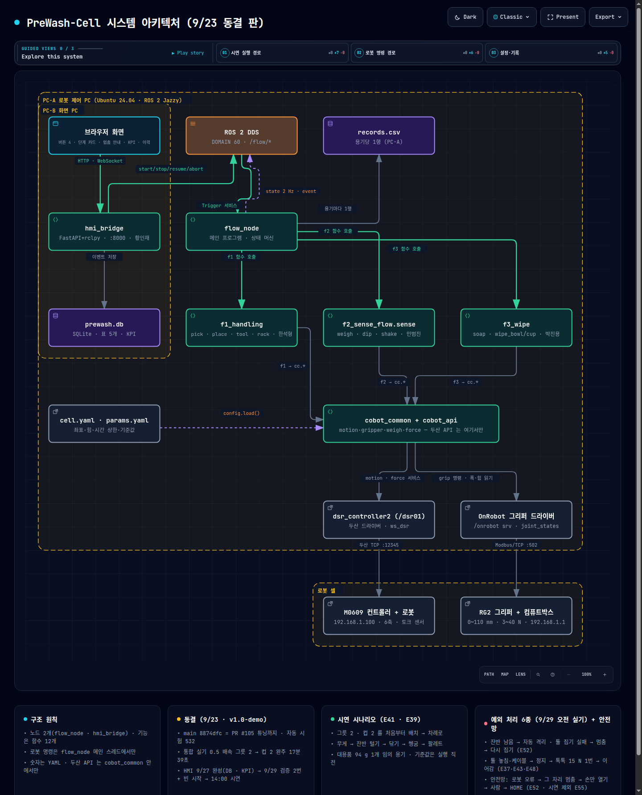
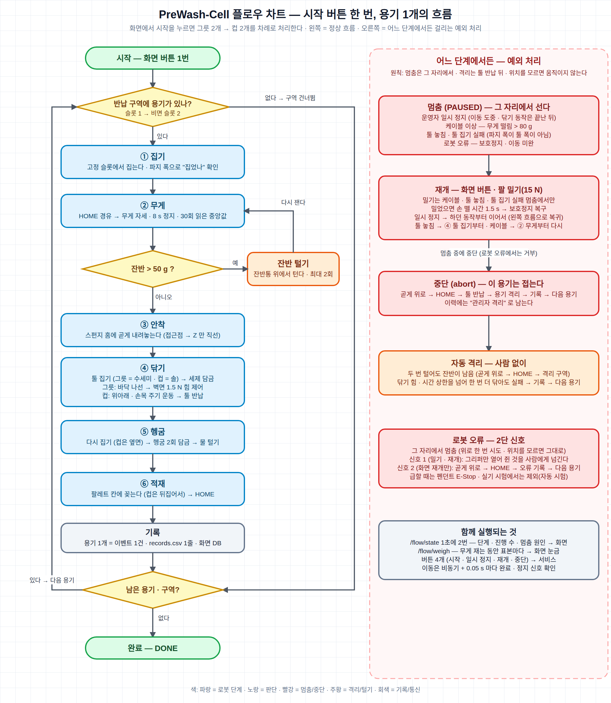
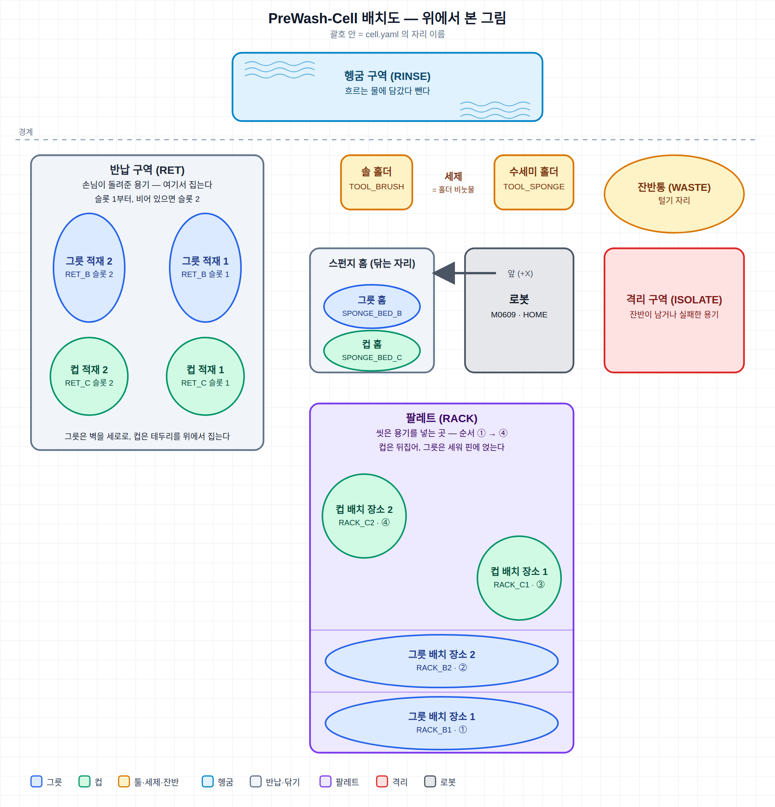

# PreWash-Cell — 협동로봇 다회용기 예비세척 · 식기세척기 팔레트 적재 자동화

반납된 다회용 그릇과 컵을 협동로봇이 집어 **잔반을 털고, 안쪽을 수세미 · 솔로 닦고, 헹군 뒤 식기세척기 팔레트에 꽂는다.** 카메라 없이 **파지 폭 · 무게 · 힘** 세 신호만으로 판단하고, 운영자는 웹 화면에서 시작 버튼 하나만 누른다.

https://github.com/user-attachments/assets/fe7334f8-1464-4c8a-8df6-dcc02b2ce02a

> 두산 ROKEY Boot Camp 9기 · 협동-1 프로젝트 "ROS2를 활용한 로봇 자동화 공정 시스템 구현" · D-2조 **디투(D2)** (한석형 · 민범진 · 박진용 · 황인재, 멘토 이일주) · 2026-09-18 ~ 09-30

| 항목 | 내용 |
|---|---|
| 하드웨어 | Doosan M0609(6축 협동로봇) + OnRobot RG2 그리퍼 |
| 소프트웨어 | Ubuntu 24.04 · ROS 2 Jazzy · Python 3.12 · FastAPI + Next.js(운영 화면) · SQLite |
| 결과 | 시작 1번으로 그릇 2 · 컵 2 무정지 완주(배속 1.0 · 약 13분) · 예외 8종 설계 · 7종 실기 복구 · 자동 시험 616개 통과 |
| 바로 해 보기 | 로봇 없이 Ubuntu 24.04 PC 한 대로 흐름과 운영 화면을 돌려 본다 → [실행 방법](#실행-방법) |

## 목차

1. [배경과 목표](#배경과-목표)
2. [주요 기능](#주요-기능)
3. [시스템 구성](#시스템-구성)
4. [결과](#결과)
5. [트러블슈팅](#트러블슈팅)
6. [배운 점 · 한계](#배운-점--한계)
7. [실행 방법](#실행-방법)
8. [개발 환경 · 사용 장비](#개발-환경--사용-장비)
9. [프로젝트 구조](#프로젝트-구조)
10. [팀 · 라이선스](#팀--라이선스)

## 배경과 목표

경기장 일회용품 규제와 지자체 사업으로 다회용기 전환이 늘고 있지만, 병목은 **회수 뒤 세척**이다. 세척센터에서도 본세척은 자동화됐지만 분류 · 애벌세척 · 랙 적재는 아직 사람 손이고, 경기 직후 수천 개가 몰리는 젖은 반복 노동이라 사람을 구하기 어렵다.

그래서 **두산 M0609 1대 + RG2 로 예비세척 전처리(잔반 제거 → 닦기 → 헹굼 → 팔레트 적재)를 자동화하는 소형 셀**을 목표로 했다. 카메라 · 전용 설비 없이 매장 단위로 놓을 수 있게 하고, 시작 버튼 1회로 연속 처리하며, 오류가 나도 격리 · 재개로 운영을 이어 가고, 처리 기록을 남겨 위생 가이드라인의 기록 요구를 맞춘다. 근거와 전체 요구사항은 [요구사항 문서](docs/01_요구사항_BR-SR.md)에 있다.

## 주요 기능

- **비전 없는 3신호 판단** — 집었는지 · 툴이 있는지는 그리퍼가 되읽는 파지 폭으로, 잔반은 무게로, 닦을 때의 접촉은 관절 토크로 추정한 툴 힘으로 본다.
- **그릇 · 컵에 맞춘 닦기** — 둘 다 접촉 하강으로 바닥을 찾는다. 그릇은 바닥 나선 → 1.5 N 힘 제어로 벽면을 돌고, 컵은 솔을 위아래 ±15 mm · 손목 ±90° 주기 운동으로 닦는다(힘 제어 없이 상한 10 N 만 감시).
- **잔반 판정과 자동 털기** — 30번(0.5 s 간격) 읽은 무게의 중앙값에서 빈 용기 기준값을 뺀다. 50 g 을 넘으면 잔반통 위에서 털고 다시 재며, 그래도 남으면 사람 없이 격리 구역으로 보낸다.
- **바로 멈추고 이어 가는 운전** — 이동 명령을 비동기로 보내고 0.05 s 마다 완료 · 정지 신호를 확인해 이동 도중에도 그 자리에서 선다. 사람을 부르는 멈춤은 원인을 치운 뒤 팔을 한 번 가볍게(15 N) 밀고 손을 떼면(1.5 s 뒤) 또는 화면에서 재개하면 이어 간다.
- **운영 화면과 기록** — 웹 화면에서 시작 · 일시 정지 · 재개 · 중단을 누르고, 단계 · 실시간 무게 · 팔레트 · 소모품 · 누적 KPI · 이력을 본다. 기록은 SQLite 표 5개와 용기별 `records.csv` 에 남는다.
- **로봇 없이 도는 개발 · 시험** — 기능 함수 13개의 약속(`cobot_api`)과 서명이 같은 가짜 기능으로 로봇 · 드라이버 없이 흐름과 화면을 돌리고, 자동 시험(`pytest`)과 화면 계산 시험(`node --test`)으로 확인한다.

## 시스템 구성

### 아키텍처

<p align="center">
  <a href="https://rokey9-d2.github.io/rokey_9_pjt1_D2/images/system_architecture_pc.html"></a><br>
  <sub><a href="https://rokey9-d2.github.io/rokey_9_pjt1_D2/images/system_architecture_pc.html">시스템 아키텍처 HTML</a> · <a href="docs/images/system_architecture_pc.png">PNG</a></sub>
</p>

**PC 2대 · 프로그램(노드) 2개**(PC 1대로도 돌아간다). 기능(집기 · 무게 · 닦기 …)은 노드가 아니라 **파이썬 함수**이고, 메인 프로그램 `flow_node` 가 순서대로 부르며 로봇 명령도 여기서만 낸다. 두 PC 는 GPU PC 의 Fast DDS Discovery Server 로 서로를 찾는다([실행 방법 5-4](docs/setup.md#5-실제-로봇)).

| 위치 | 구성 | 역할 |
|---|---|---|
| GPU PC (로봇과 유선) | Discovery Server · 두산 · RG2 드라이버 · `flow_node` | 기능 함수 호출 · 실패 처리 · 정지/재개/중단 · 용기별 기록 · 로봇 명령 |
| 화면 PC (무선) | `hmi_bridge`(FastAPI · WebSocket) · 웹 화면(Next.js) · SQLite | 운영 화면과 기록 DB(`prewash.db`) |

| 통신 | 종류 | 방향 | 내용 |
|---|---|---|---|
| `/flow/state` | 토픽 · 1초에 2번 | `flow_node` → `hmi_bridge` | 지금 단계 · 진행 수 · 멈춤 원인 |
| `/flow/event` | 토픽 · 용기마다 1건 | `flow_node` → `hmi_bridge` | 용기 1개의 결과(무게 · 걸린 시간 · 완료/격리) |
| `/flow/weigh` | 토픽 · 무게 재는 동안 | `flow_node` → `hmi_bridge` | 재고 있는 무게 표본 |
| `/flow/start` · `stop` · `resume` · `abort` | 서비스 | `hmi_bridge` → `flow_node` | 화면 버튼(시작 · 일시 정지 · 재개 · 중단) |

좌표 · 힘 · 횟수 · 시간은 코드가 아니라 설정 파일 두 개(`src/cobot_common/config/cell.yaml` · `params.yaml`)에 있다. 패키지별 역할은 [src/README.md](src/README.md), 함수 · 메시지 약속은 [인터페이스 문서](docs/02_인터페이스_IRD.md)에 있다.

### 동작 흐름

<p align="center">
  <br>
  <sub>왼쪽: 용기 1개의 정상 흐름 · 오른쪽: 예외 처리 · <a href="docs/images/flow_chart.svg">플로우 차트 SVG</a></sub>
</p>

```
① 집기   반납 구역의 고정 슬롯에서 용기를 집는다 (슬롯 1 → 비면 슬롯 2)
② 무게   HOME 을 거쳐 무게 재는 자세(집은 자리 위 100 mm)에서 든 채로 잰다 → 잔반이 50 g 을 넘으면 잔반통 위에서 털고 다시 잰다
③ 안착   스펀지 홈에 용기를 놓는다
④ 닦기   툴 집기(그릇 = 수세미 · 컵 = 솔) → 세제 → 안쪽 닦기 → 툴 반납
⑤ 헹굼   용기를 다시 집어 헹굼 구역에 2회 담근 뒤 물을 턴다
⑥ 적재   식기세척기 팔레트 칸에 꽂는다(컵은 뒤집어서) → HOME → 다음 용기
```

그릇 2개 → 컵 2개를 순서대로 처리하고 용기마다 기록을 남긴다. 상태 머신 전체는 [설계 문서 §5.1](docs/03_설계_SDD.md)에 있다.

### 예외 처리

사람을 부르는 멈춤에서는 쥔 것을 그대로 두고 그 자리에 선다. 격리할 때는 곧게 위로 빠져 툴을 홀더에 반납한 뒤 옮긴다. 로봇 위치를 모르면 스스로 움직이지 않는다.

| 상황 | 로봇 | 사람 |
|---|---|---|
| 반납 구역이 비어 있다 | 그 구역을 건너뛴다 | — |
| 털어도 잔반이 남는다 · 닦기 힘/시간 상한을 넘었다 | 닦기는 즉시 멈추고 위로 빠진 뒤, 툴을 쥐고 있으면 한 번 더 닦는다(툴이 없으면 툴 놓침 멈춤). 그래도 실패하거나 잔반이 남으면 사람 없이 격리 구역으로 보내고 다음 용기로 간다 | — |
| 케이블 이상 · 툴 놓침 · 툴 집기 실패 | 그 자리에서 멈춘다 | 케이블을 풀거나 툴을 홀더에 꽂고, 팔을 가볍게 한 번 밀고 손을 떼거나(1.5 s 뒤 움직임) 화면에서 재개 → 케이블은 무게 단계부터, 툴은 툴 집기부터 다시 한다 |
| 운영자 일시 정지 · 중단 | 이동 도중에도 그 자리에서 멈춘다(닦기 동작 중이면 그 동작이 끝난 뒤). 멈춘 상태에서 중단하면 툴을 반납하고 용기를 격리한 뒤 다음 용기로 간다(로봇 오류 · 케이블 이상 멈춤에서는 중단을 받지 않는다) | 재개하면 하던 동작부터 이어 간다. 중단한 용기는 이력에 "관리자 격리"로 남는다 |
| 로봇 오류(보호 정지 등) | 그 자리에서 멈춘다(예외였으면 곧게 위로 한 번만 시도). 사람 신호 전까지 움직이지 않는다 | 밀기 · 재개 → 그리퍼만 열려 쥔 것을 받는다 → 화면 재개 → 곧게 위로 → HOME → 다음 용기 |

전체 예외 · 오류 목록은 [설계 문서 §7](docs/03_설계_SDD.md)에 있다.

## 결과

실기(Doosan M0609)와 로봇 없는 자동 시험에서 확인한 값이다. 최종 실기(9/30)에서도 전체 흐름과 예외 처리가 모두 정상 동작했다. 근거는 [결과표](docs/04_결과_결과표.md)와 [시험 기록](docs/test-reports/)에 있다.

| 항목 | 결과 | 목표 | 판정 |
|---|---|---|---|
| 완전성 | 배속 0.5 완주 3회 · 배속 1.0 무정지 완주 1회(약 13분) · 사람 개입 0 | 시작 1회로 그릇 2 · 컵 2 를 팔레트까지 | 달성 |
| 잔반 판정 | 98 g 대용품 4/4 감지 · 빈 용기 오판 0/8 | 대용품 100 % · 오판 0 (임계 50 g) | 달성 |
| 파지 · 안착 · 적재 | 슬롯 집기 12/12 · 홈 놓기 12/12 · 컵 재파지 6/6 · 팔레트 12/12 · 낙하 0 | 90 % 이상 · 낙하 0 | 달성 |
| 닦기 힘 | 그릇 평균 2.64 / 2.06 N · 최대 6.91 / 6.34 N(그릇 1 / 2 · 바닥 나선 포함) · 컵 최대 3.39 N · 힘 로그 기록 | 상한(10 N) 초과 0 · 초과 시 즉시 후퇴 | 달성 |
| 예외 복구 | 예외 8종 설계 · 7종 실기(6종 + 빈 시작) 모두 정의대로 복구 · 로봇 오류는 안전망(실기 시험 제외 · 자동 시험) | 실패마다 재시도 · 격리 · 정지 · 재개가 정의대로 | 달성 |
| 운영 화면 · 기록 | 기록 누락 0 · 두 PC 사이 버튼 응답 7~96 ms(무선) | 누락 0 · 응답 1 s 이내 | 달성 |
| 용기당 사이클 타임 | 배속 1.0 에서 그릇 153 · 219 s(잔반 털기 1회 포함) · 컵 182 · 192 s · 평균 186.5 s | 90 s 이내 | **미달** |
| 자동 시험 | `pytest` 616 passed · 9 skipped · 1 xfailed · 화면 계산 15 pass | 로봇 없이 실패 0 | 달성 |

## 트러블슈팅

개발 중 만난 문제 가운데 구조 · 측정 · 정지 · 동선을 바꾼 대표 4가지다. 전체 8건은 [트러블슈팅 기록](docs/troubleshooting/)에 있다.

### 1. 콜백 안 로봇 명령 교착 → 실행 구조 변경

- **문제** — 처음 설계(기능 노드 3개가 서비스 콜백 안에서 로봇을 움직임)대로 만들면 두 번째 명령부터 응답 없이 멈추고, 다른 프로세스의 명령은 조용히 덮어써졌다.
- **원인** — 두산 API 는 명령마다 실행기를 직접 돌리는데, 콜백 안에서는 이미 실행기가 그 콜백을 처리하는 중이다.
- **해결** — 구조 5가지를 가상 로봇으로 비교 시험해 "기능은 함수, 메인 스레드가 차례로 부르고 통신만 별도 스레드"로 바꿨다. 로봇 명령은 메인 프로그램 한 곳에서만 나간다.
- **결과** — 연속 6회 성공 · 모션 중 상태 발행 2 Hz 유지. ([TS-01](docs/troubleshooting/TS-01_두산API_초기화_실행기_교착.md))

### 2. 무게가 자세 · 시간에 따라 출렁임 → 그리퍼 케이블 장력

- **문제** — 같은 무게 자세인데 오는 길에 따라 90 g 이 달랐고(집은 자리에서 곧장 −113 g · HOME 경유 −23 g), 빈 그릇 10회 측정의 폭이 44.8 g 으로 기준(20 g)을 넘었다.
- **원인** — 팽팽한 그리퍼 케이블이 자세와 시간에 따라 툴을 당겼다.
- **해결** — 케이블 여유를 늘리고, 무게는 항상 HOME 을 거쳐 같은 자세에서 재며, 빈 용기 기준값은 실행 직전에 다시 잰다.
- **결과** — 21 s 측정 창의 흔들림 ±12~17 g · 96 g 물건 오차 +3 g 으로 잔반 임계 50 g 을 판정할 수 있게 됐다(98 g 대용품 4/4 감지 · 빈 용기 오판 0/8). ([V-02 시험 기록](docs/test-reports/20260922_V-02_무게기준값_황인재.md))

### 3. 일시 정지가 이동이 끝난 뒤에야 걸림 → 비동기 이동 + 짧은 확인

- **문제** — 이동 도중 일시 정지를 눌러도 그 이동이 끝난 뒤(4.97 s 뒤)에야 멈췄다.
- **원인** — 이동 명령이 끝날 때까지 기다리는 동기 방식이라, 이동 중에는 정지 신호를 처리할 틈이 없었다.
- **해결** — 이동을 비동기로 보내고 0.05 s 마다 완료 · 정지 신호를 확인하게 바꿨다.
- **결과** — 가상 시험 10/10, 실기에서도 툴을 든 채 정지 → 재개로 하던 동작을 이어 갔다. ([V-24 시험 기록](docs/test-reports/20260921_V-24_실기_일시정지_황인재.md))

### 4. 재파지 · 툴 반납 중 안전정지 → 접근점에서 Z 만 곧게 + 15 mm 완충

- **문제** — 9/23 컵 재파지 중 안전정지가 걸렸고, 힘을 감시하며 내려가는 동작은 한 걸음(3 mm)에 약 3 s 가 걸려 느렸다.
- **원인** — HOME 에서 관절 이동으로 곧장 가다 열린 그리퍼가 컵 · 홈 틀에 걸린 것으로 보았다.
- **해결** — 놓기 · 적재 · 툴 반납 · 재파지는 접근점에서 자세를 맞춘 뒤 Z 만 곧게 내리고, 마지막 15 mm 만 30 mm/s 로 천천히 내린다. 힘 감시는 닦기 · 바닥 찾기 같은 접촉 동작에만 남겼다.
- **결과** — 0.5 배속 통합 12회 정상 · 컵 재파지 6/6, 9/29 배속 1.0 무정지 완주로 이어졌다. ([결정 기록 E44](docs/decisions/20260919_결정기록_DSN-03.md))

## 배운 점 · 한계

**배운 점**

- 인터페이스를 먼저 고정하니, 로봇 1대를 나눠 쓰는 4명이 로봇 없이도 병렬로 개발할 수 있었다.
- 로봇팔의 힘 센서로 잰 무게는 케이블 같은 하드웨어 요인에 크게 흔들렸다. 값이 이상하면 코드보다 측정 조건부터 확인해야 한다.
- 바뀐 것마다 검증 수준(자동 시험 / 가상 / 실기)을 적게 하니, 실기 확인 전인 변경이 확인된 것처럼 병합되는 일을 막을 수 있었다.

**한계와 다음에 할 것**

- 용기당 사이클 타임이 153~219 s 로 목표(90 s)에 못 미쳤다. 무게 단계(HOME 경유 + 안정 대기 8 s)와 재파지 · 헹굼 단계가 가장 오래 걸렸다.
- 닦기 동작 중에 일시 정지를 누르면 그 동작이 끝난 뒤 멈춘다(컵 주기 운동 약 13 s). 즉시 멈추고 재개 때 닦기를 처음부터 하도록 바꾸는 것이 다음 과제다.
- 헹굼은 과정 안전 규정에 따라 물 없이 모션만 했고, 잔반은 대용품으로 시험했다.
- 격리 구역이 그릇 · 컵 공용 한 곳이라 다음 격리 전에 사람이 치워야 한다.
- `cell.yaml` 좌표는 우리 워크셀 기준이라 다른 셀에서는 다시 티칭해야 한다.

## 실행 방법

로봇 없이 Ubuntu 24.04 · ROS 2 Jazzy PC 한 대에서 흐름과 운영 화면을 돌려 볼 수 있다. 필요한 패키지 설치, 운영 화면 부품, 실제 로봇(PC 1대 · 2대) 절차는 **[docs/setup.md](docs/setup.md)** 에 있다.

```bash
# 받기 · 빌드 · 자동 시험 (ROS 2 Jazzy · colcon · pytest 설치 뒤 — setup.md 1~2)
cd ~ && git clone https://github.com/rokey9-d2/rokey_9_pjt1_D2.git rokey_pjt01_ws
cd ~/rokey_pjt01_ws && source /opt/ros/jazzy/setup.bash
colcon build --symlink-install && source install/setup.bash
python3 -m pytest -q src

# 로봇 없이 실행 (운영 화면 부품 설치 뒤 — setup.md 3) → 브라우저 http://localhost:8000 에서 시작
export ROS_AUTOMATIC_DISCOVERY_RANGE=LOCALHOST
ros2 launch prewash_bringup prewash_mock.launch.py
```

## 개발 환경 · 사용 장비

| 항목 | 값 |
|---|---|
| OS · ROS | Ubuntu 24.04 LTS · ROS 2 Jazzy · Fast DDS(`rmw_fastrtps_cpp`) + Discovery Server |
| 로봇 드라이버 | 교육 과정 배포본 `doosan-robot2`(`DSR_ROBOT2` · `DR_init`) · `onrobot_rg_control` · `m0609_rg2_bringup` — 저장소 밖 `~/ws_cobot_pjt/ws_dsr` · 제어기 Dart Platform 2.12.1 |
| 화면 | FastAPI · uvicorn · WebSocket(`hmi_bridge`, 포트 8000) · Next.js 15 · React 19(정적 빌드) · SQLite · Node.js 18.18 이상 |
| 의존성 | apt([실행 방법 1~3](docs/setup.md)) · pip [`requirements.txt`](requirements.txt) · npm [`package.json`](src/f4_hmi/web/package.json) |
| 언어 · 도구 | Python 3.12 · JavaScript · colcon · pytest · `node --test` |

| 장비 | 모델명 · 사양 | 수량 | 용도 |
|---|---|---|---|
| 협동로봇 | Doosan M0609 (6축 · 가반하중 6 kg · 도달 거리 900 mm) + 제어기 · 티치 펜던트 | 1 | 용기 · 툴 이송, 닦기 · 무게 · 접촉 감지(관절 토크) |
| 그리퍼 | OnRobot RG2 (스트로크 0~110 mm · 파지 힘 3~40 N · 폭 피드백) | 1 | 용기 · 툴 파지 · 파지 폭 되읽기 |
| 툴 | 수세미 툴(그릇용 · 지름 90 mm) · 수세미 솔(컵용 · 길이 95 mm) | 각 1 | 안쪽 닦기. 툴 홀더 2개의 비눗물에 담가 세제를 묻힌다 |
| 셀 구성품 | 반납 구역 2곳(구역마다 고정 슬롯 2개) · 잔반통 · 스펀지 고정틀 · 헹굼 구역 · 격리 구역 · 식기세척기 팔레트 모형(그릇 2칸 · 컵 2칸) | — | 헹굼은 물 없이 모션만(과정 안전 규정) |
| 처리 대상 | 다회용 그릇 · 컵 | 각 2 | 시연 · 시험 |
| 잔반 대용품 | 털면 떨어지는 고형물 94 g(시연) · 98 g(9/23 시험) | 각 1 | 잔반 판정 시험 |
| PC | Ubuntu 24.04 · ROS 2 Jazzy | 2 | GPU PC(로봇 제어 · 유선) · 화면 PC(운영 화면 · 무선) |

<p align="center">
  <br>
  <sub>워크셀 배치(위에서 본 그림) · <a href="docs/images/layout_workcell.svg">배치도 SVG</a></sub>
</p>

## 프로젝트 구조

```text
rokey_pjt01_ws/                ROS 2 워크스페이스 (저장소 루트)
├── src/                       ROS 2 패키지 8개 · 패키지 지도는 src/README.md
│   ├── cobot_api/             기능 함수 13개의 약속(이름 · 인자 · 결과 · 실패 코드) — 로봇 코드 없음
│   ├── cobot_common/          두산 API · 그리퍼를 감싼 공용 로봇 함수 + 설정 파일 config/*.yaml
│   ├── cobot_msgs/            메시지 3개 — FlowState · FlowEvent · WeighLive
│   ├── f1_handling/           집기 · 다시 집기 · 놓기 · 이동 · 툴 집기/반납 · 팔레트 꽂기 (함수 6개)
│   ├── f2_sense_flow/         무게 · 잔반 털기 · 헹굼 · 물 털기 (함수 4개) + 메인 프로그램 flow_node (상태 머신)
│   ├── f3_wipe/               세제 · 그릇 닦기 · 컵 닦기 (함수 3개)
│   ├── f4_hmi/                운영 화면 hmi_bridge · 웹(Next.js) · 기록 DB(SQLite) · 가짜 흐름
│   ├── prewash_bringup/       launch 2개 — 실기용 · 로봇 없이(mock)
│   └── */test/                자동 시험 test_*.py · 단독 시험대 rig_*.py
├── docs/                      문서 지도는 docs/README.md — 실행 절차(setup.md) · 요구사항 · 인터페이스 · 설계 · 결과표 · 결정 기록 · 시험 기록 · 트러블슈팅 · 환경 설정 · 그림
├── requirements.txt           pip 의존성 (운영 화면 서버용 가상환경 · 화면 시험)
├── LICENSE                    Apache-2.0
└── README.md
```

## 팀 · 라이선스

| 이름 | 역할 |
|---|---|
| 한석형(팀장) | 파지 · 이송 · 적재 · 좌표 티칭 · 워크셀 기구 제작 · 시연 영상 |
| 민범진 | 무게 측정 · 잔반 판정 · 털기 · 헹굼 · 흐름 상태 머신 · 케이블 감지 · 넛지 재개 |
| 박진용 | 세제 · 접촉 닦기 힘 제어 · 스펀지 고정틀 제작 · 공용 힘 함수 · 안전 파라미터 |
| 황인재 | PM · 인터페이스(`cobot_api` · `cobot_msgs`) · 운영 화면 · 기록 DB · KPI · 통합 · 문서 |

[Apache License 2.0](LICENSE) — Copyright 2026 Team D2 (ROKEY 9기 협동1 D그룹 2조). 두산 · OnRobot 드라이버(`ws_dsr`, 저장소 밖)는 각 제공자의 라이선스를 따른다.
