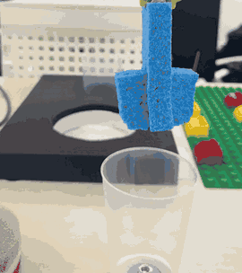
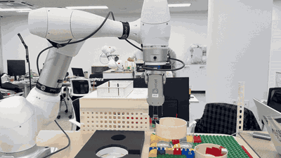
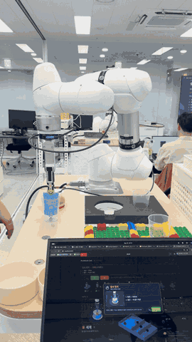
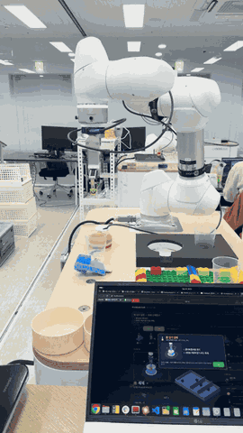
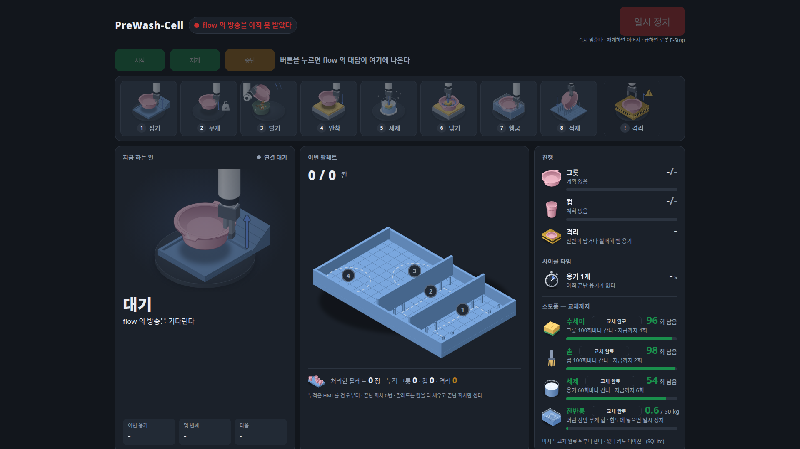
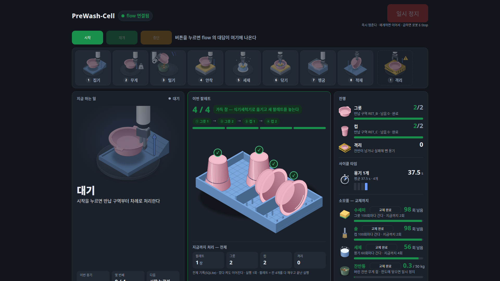
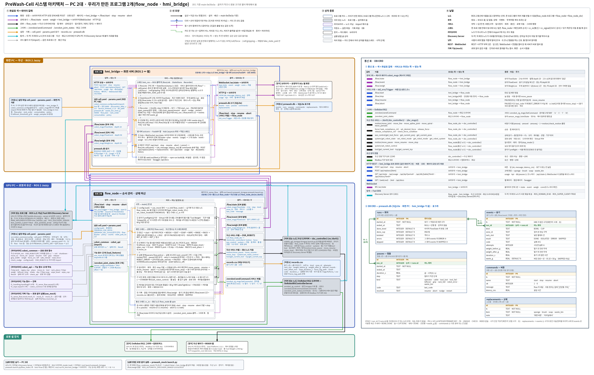

# 🧽 PreWash-Cell — 카메라 없이, 협동로봇이 다회용기를 닦아 세척기에 꽂는다

<p align="center">
  
  
  
  
  
  
  
  
</p>

반납된 다회용 그릇과 컵을 협동로봇이 집어 **잔반을 털고, 안쪽을 수세미 · 솔로 닦고, 헹군 뒤 식기세척기 팔레트에 꽂습니다.** 카메라 없이 **파지 폭 · 무게 · 힘** 세 신호만으로 판단하고, 운영자는 웹 화면에서 시작 버튼 하나만 누릅니다.

> 두산 로보틱스 ROKEY Boot Camp 9기 · 협동-1 "ROS2를 활용한 로봇 자동화 공정 시스템 구현" · D-2조 **디투(D2), 4명** — 한석형(팀장) · 민범진 · 박진용 · 황인재 · 멘토 이일주 · 2026.09.18 ~ 09.30(13일)

> 🙋 **박진용 — F3 접촉 닦기 · 공용 힘 함수 · 안전 담당** · [내 역할 자세히 보기](#-내-역할--박진용)

## 📑 목차

1. [🎬 데모](#-데모)
2. [💡 한눈에](#-한눈에)
3. [✨ 핵심 기능](#-핵심-기능)
4. [🛠️ 시스템 구조](#️-시스템-구조)
5. [🧩 트러블슈팅](#-트러블슈팅)
6. [📊 결과](#-결과)
7. [🌱 배운 점 · 한계](#-배운-점--한계)
8. [🙋 내 역할 — 박진용](#-내-역할--박진용)
9. [👥 팀 · 역할](#-팀--역할)
10. [🤝 개발 · 협업 방식](#-개발--협업-방식)
11. [💻 개발 환경 · 장비](#-개발-환경--장비)
12. [🚀 설치 · 실행](#-설치--실행)
13. [📁 문서](#-문서)
14. [라이선스](#라이선스)

## 🎬 데모

### ▶ 1분 시연 영상

https://github.com/user-attachments/assets/fe7334f8-1464-4c8a-8df6-dcc02b2ce02a

경기장에서 반납된 다회용기가 셀에 들어와, 시작 버튼 한 번으로 그릇 · 컵이 팔레트에 꽂히기까지의 흐름입니다. 기능별 실기 GIF는 아래 [✨ 핵심 기능](#-핵심-기능)에 있습니다.

## 💡 한눈에

| 문제 | 우리 방법 |
|---|---|
| 다회용기는 늘지만, 회수 뒤 잔반 제거 · 애벌세척 · 랙 적재는 아직 사람 손이다 | 협동로봇 1대가 집기 → 잔반 → 닦기 → 헹굼 → 팔레트 적재를 시작 버튼 한 번으로 이어서 합니다 |
| 매장 · 게이트 단위 소형 셀에는 카메라 · 전용 설비를 두기 어렵다 | 카메라 없이 그리퍼 **파지 폭**, 관절 토크로 추정한 **무게 · 힘**, 세 신호로 판단합니다 |
| 위생 지침은 반납 수량 · 처리 기록을 요구한다 | 용기마다 무게 · 시간 · 결과를 SQLite에 남기고 운영 화면에 누적 KPI로 보여 줍니다 |
| 오류가 나면 셀이 서 버린다 | 예외 8종마다 재시도 · 격리 · 정지 · 재개를 정해, 사람이 필요한 때만 부릅니다 |

로봇과 그리퍼가 원래 가진 신호만으로 판단하고, **혼자 해결할 수 있는 실패는 격리하고 다음 용기로, 사람이 필요한 실패는 그 자리에 멈춰 안내**합니다.

```text
[시작] → ① 집기 → ② 무게(잔반 50 g 넘으면 털고 다시) → ③ 스펀지 홈 안착 → ④ 툴 집기 · 세제 · 닦기 · 툴 반납 → ⑤ 헹굼 · 물 털기 → ⑥ 팔레트 적재 → 다음 용기
예외: 빈 구역 건너뛰기 · 잔반 남음 → 격리 · 툴 놓침 / 툴 집기 실패 / 케이블 이상 → 멈춤 → 사람이 고치고 팔을 밀거나 화면에서 재개
```

<details>
<summary>배경 — 왜 다회용기 예비세척인가</summary>

경기장 일회용품 규제와 지자체 사업으로 다회용기 전환이 늘고 있지만, 병목은 **회수 뒤 세척**입니다. 세척센터에서도 본세척은 자동화됐지만 분류 · 애벌세척 · 랙 적재는 아직 사람 손이고, 경기 직후 수천 개가 몰리는 젖은 반복 노동이라 사람을 구하기 어렵습니다.

그래서 **두산 M0609 1대 + RG2로 예비세척 전처리(잔반 제거 → 닦기 → 헹굼 → 팔레트 적재)를 자동화하는 소형 셀**을 목표로 했습니다. 카메라 · 전용 설비 없이 매장 단위로 놓을 수 있게 하고, 시작 버튼 1회로 연속 처리하며, 오류가 나도 격리 · 재개로 운영을 이어 가고, 처리 기록을 남겨 위생 가이드라인의 기록 요구를 맞춥니다. 근거와 전체 요구사항은 [요구사항 문서](docs/01_요구사항_BR-SR.md)에 있습니다.

</details>

## ✨ 핵심 기능

### 🧽 그릇 · 컵에 맞춘 닦기
둘 다 접촉 하강으로 바닥을 찾은 뒤, 그릇은 바닥 나선 → **1.5 N 힘 제어로 벽면**을 돌고, 컵은 솔을 **위아래 ±15 mm · 손목 ±90°** 주기 운동으로 닦습니다.

<p align="center">
  <br>
  <sub>컵 — 솔을 위아래로 움직이며 손목을 돌려 닦기(2배속)</sub>
</p>

<details>
<summary>자세히</summary>

- **툴:** 그릇은 수세미 툴(지름 90 mm), 컵은 수세미 솔(길이 95 mm)을 씁니다. 툴 홀더 2개의 비눗물에 담가 세제를 묻힙니다.
- **힘:** 그릇은 힘 제어로 벽면을 돌고(닦기 힘 평균 그릇 1 2.64 N · 그릇 2 2.06 N, 최대 6.91 N · 6.34 N), 컵은 힘 제어 없이 상한 10 N만 감시합니다. 상한 초과는 0번이었습니다.
- **상한을 넘으면:** 닦기를 즉시 멈추고 위로 빠진 뒤, 툴을 쥐고 있으면 한 번 더 닦습니다. 그래도 실패하면 사람 없이 격리 구역으로 보냅니다.

</details>

### ⚖️ 잔반 판정과 자동 털기
무게를 30번(0.5 s 간격) 읽은 중앙값에서 빈 용기 기준값을 빼고, **50 g을 넘으면 잔반통 위에서 털고 다시 잽니다.** 그래도 남으면 사람 없이 격리 구역으로 보냅니다.

<details>
<summary>자세히</summary>

- **저울 없이:** 전용 저울 없이 로봇팔 관절 토크로 추정한 툴 힘으로 잽니다. 그래서 측정 조건이 중요합니다 — 항상 HOME을 거쳐 같은 자세에서 재고, 빈 용기 기준값은 실행 직전에 다시 잽니다([트러블슈팅 2](#-트러블슈팅)).
- **결과:** 98 g 대용품 4번 중 4번 감지 · 빈 용기 8번 중 오판 0번(임계 50 g).
- **실시간 표시:** 재는 동안의 무게 표본을 운영 화면에 그대로 보여 줍니다(`/flow/weigh`).

</details>

### ⏸️ 바로 멈추고, 팔을 밀어 이어 가기
이동 명령을 비동기로 보내고 0.05 s마다 완료 · 정지 신호를 확인해 **이동 도중에도 그 자리에서 섭니다**. 툴 놓침 · 툴 집기 실패 · 케이블 이상으로 멈췄을 때는 원인을 치운 뒤 **팔을 한 번 가볍게(15 N) 밀고 손을 떼면** 1.5 s 뒤 이어 갑니다. 이런 멈춤은 화면의 [재개]로도 이어 갈 수 있고, 일시 정지는 [재개]로만 풀립니다.

<p align="center">
  <br>
  <sub>멈춘 팔을 가볍게 밀고 손을 떼면 다시 움직임</sub>
</p>

<details>
<summary>자세히</summary>

- **일시 정지:** 이동 도중에도 그 자리에서 멈추고, 재개하면 하던 동작부터 이어 갑니다. 닦기 동작 중이면 그 동작이 끝난 뒤 멈춥니다.
- **중단:** 멈춘 상태에서 중단하면 툴을 반납하고 용기를 격리한 뒤 다음 용기로 갑니다. 이력에는 "관리자 격리"로 남습니다.
- **안전:** 로봇 위치를 모르면 스스로 움직이지 않고, 비상 정지는 E-Stop입니다.

</details>

### 🛟 예외 처리 — 혼자 해결할 건 격리, 사람이 필요하면 그 자리에 멈춤
툴 놓침 · 툴 집기 실패 · 케이블 이상처럼 사람이 필요한 실패에서는 **쥔 것을 그대로 두고 그 자리에 서서** 원인을 화면에 알립니다. 사람이 고치면 툴 집기 · 무게 단계부터 다시 합니다.

<table>
  <tr>
    <td width="50%" align="center"><br><sub>툴 놓침 → 멈춤 → 툴을 다시 꽂고 팔을 밀어 재개(2배속)</sub></td>
    <td width="50%" align="center"><br><sub>툴 집기 실패 → 툴을 홀더에 꽂고 재개(1.5배속)</sub></td>
  </tr>
</table>

<details>
<summary>상황별 처리 표</summary>

사람을 부르는 멈춤에서는 쥔 것을 그대로 두고 그 자리에 섭니다. 격리할 때는 곧게 위로 빠져 툴을 홀더에 반납한 뒤 옮깁니다. 로봇 위치를 모르면 스스로 움직이지 않습니다.

| 상황 | 로봇 | 사람 |
|---|---|---|
| 반납 구역이 비어 있다 | 그 구역을 건너뜁니다 | — |
| 털어도 잔반이 남는다 · 닦기 힘/시간 상한을 넘었다 | 닦기는 즉시 멈추고 위로 빠진 뒤, 툴을 쥐고 있으면 한 번 더 닦습니다(툴이 없으면 툴 놓침 멈춤). 그래도 실패하거나 잔반이 남으면 사람 없이 격리 구역으로 보내고 다음 용기로 갑니다 | — |
| 케이블 이상 · 툴 놓침 · 툴 집기 실패 | 그 자리에서 멈춥니다 | 케이블을 풀거나 툴을 홀더에 꽂고, 팔을 가볍게 한 번 밀고 손을 떼거나(1.5 s 뒤 움직임) 화면에서 재개 → 케이블은 무게 단계부터, 툴은 툴 집기부터 다시 합니다 |
| 운영자 일시 정지 · 중단 | 이동 도중에도 그 자리에서 멈춥니다(닦기 동작 중이면 그 동작이 끝난 뒤). 멈춘 상태에서 중단하면 툴을 반납하고 용기를 격리한 뒤 다음 용기로 갑니다(로봇 오류 · 케이블 이상 멈춤에서는 중단을 받지 않습니다) | 재개하면 하던 동작부터 이어 갑니다. 중단한 용기는 이력에 "관리자 격리"로 남습니다 |
| 로봇 오류(보호 정지 등) | 그 자리에서 멈춥니다(예외였으면 곧게 위로 한 번만 시도). 사람 신호 전까지 움직이지 않습니다 | 밀기 · 재개 → 그리퍼만 열리면 쥐고 있던 물건을 받습니다 → 화면 재개 → 곧게 위로 → HOME → 다음 용기 |

실패 코드별 전체 목록(닦기 힘 · 시간 상한, 집기 실패, 팔레트 가득 등 포함)은 [설계 문서 §7](docs/03_설계_SDD.md)에 있습니다.

</details>

### 🖥️ 운영 화면과 기록
웹 화면에서 **시작 · 일시 정지 · 재개 · 중단**을 누르고, 단계 · 실시간 무게 · 팔레트 · 소모품 · 누적 KPI · 이력을 봅니다. 멈추면 원인과 할 일을 안내합니다. 기록은 SQLite 표 5개와 용기별 `records.csv`에 남습니다.

<table>
  <tr>
    <td width="50%" align="center"><br><sub>운영 화면 — 단계 · 실시간 무게 · 팔레트 · 소모품</sub></td>
    <td width="50%" align="center"><br><sub>누적 KPI · 이력</sub></td>
  </tr>
</table>

두 PC를 무선으로 이은 구성에서 버튼 응답 7 ~ 96 ms, 기록 누락 0이었습니다.

### 🧪 로봇 없이 도는 개발 · 시험
기능 함수 13개의 약속(`cobot_api`)과 서명이 같은 **가짜 기능**으로 로봇 · 드라이버 없이 흐름과 화면을 돌리고, 자동 시험(`pytest` 616개 통과)과 화면 계산 시험(`node --test` 15개)으로 확인합니다. 4명이 로봇 1대를 나눠 쓰면서도 각자 개발할 수 있었던 바탕입니다.

## 🛠️ 시스템 구조

**PC 2대 · 노드 2개**(PC 1대로도 돌아갑니다). 기능(집기 · 무게 · 닦기 …)은 노드가 아니라 **파이썬 함수**이고, 메인 프로그램 `flow_node`가 차례로 부르며 로봇 명령도 여기서만 냅니다. 두 PC는 로봇 PC의 Fast DDS Discovery Server로 서로를 찾습니다.

<p align="center">
  <br>
  <sub>프로그램 카드마다 입력 → 처리 → 출력 · 화살표 색 = 데이터 갈래(범례는 그림 맨 위) · 오른쪽은 통신 표와 DB ERD · 그림을 누르면 원본 크기로 열립니다</sub>
</p>

| 브라우저에서 바로 보기 | 무엇이 보이나 |
|---|---|
| <a href="https://viewer.diagrams.net/?lightbox=1&nav=1#Uhttps%3A%2F%2Fraw.githubusercontent.com%2Frokey9-d2%2Frokey_9_pjt1_D2%2Fmain%2Fdocs%2Fimages%2Fsystem_architecture.drawio"></a> | 위 그림의 draw.io 원본 — 확대 · 이동 · 프로그램 카드 · 토픽 · 서비스 선 · 통신 표 · DB ERD |
| <a href="https://rokey9-d2.github.io/rokey_9_pjt1_D2/images/archify/index.html#arch"></a> | 탭 4개 — 시스템 아키텍처 · 플로우 차트 · 상태 머신 · DB ERD(움직임 · 다크 모드 · 경로 보기 · 내보내기) |

<details>
<summary>PC 배치 · 통신 · 동작 흐름 · 플로우 차트</summary>

| 위치 | 구성 | 역할 |
|---|---|---|
| 로봇 PC (로봇과 유선) | Discovery Server · 두산 · RG2 드라이버 · `flow_node` | 기능 함수 호출 · 실패 처리 · 정지/재개/중단 · 용기별 기록 · 로봇 명령 |
| 웹 PC (무선) | `hmi_bridge`(FastAPI · WebSocket) · 웹 화면(Next.js) · SQLite | 운영 화면과 기록 DB(`prewash.db`) |

| 통신 | 종류 | 방향 | 내용 |
|---|---|---|---|
| `/flow/state` | 토픽 · 1초에 2번 | `flow_node` → `hmi_bridge` | 지금 단계 · 진행 수 · 멈춤 원인 |
| `/flow/event` | 토픽 · 용기마다 1건 | `flow_node` → `hmi_bridge` | 용기 1개의 결과(무게 · 걸린 시간 · 완료/격리) |
| `/flow/weigh` | 토픽 · 무게 재는 동안 | `flow_node` → `hmi_bridge` | 재고 있는 무게 표본 |
| `/flow/start` · `stop` · `resume` · `abort` | 서비스 | `hmi_bridge` → `flow_node` | 화면 버튼(시작 · 일시 정지 · 재개 · 중단) |

좌표 · 힘 · 횟수 · 시간 같은 조정 값은 대부분 코드가 아니라 설정 파일 두 개(`src/cobot_common/config/` 아래 `cell.yaml` · `params.yaml`)에 있습니다. 패키지별 역할은 [src/README.md](src/README.md), 함수 · 메시지 약속은 [인터페이스 문서](docs/02_인터페이스_IRD.md)에 있습니다.

**동작 흐름**

```
① 집기   반납 구역의 고정 슬롯에서 용기를 집는다 (슬롯 1 → 비면 슬롯 2)
② 무게   HOME을 거쳐 무게 재는 자세(집은 자리 위 100 mm)에서 든 채로 잰다 → 잔반이 50 g을 넘으면 잔반통 위에서 털고 다시 잰다
③ 안착   스펀지 홈에 용기를 놓는다
④ 닦기   툴 집기(그릇 = 수세미 · 컵 = 솔) → 세제 → 안쪽 닦기 → 툴 반납
⑤ 헹굼   용기를 다시 집어 헹굼 구역에 2회 담근 뒤 물을 턴다
⑥ 적재   식기세척기 팔레트 칸에 꽂는다(컵은 뒤집어서) → HOME → 다음 용기
```

그릇 2개 → 컵 2개를 순서대로 처리하고 용기마다 기록을 남깁니다. 상태 머신 전체는 [설계 문서 §5.1](docs/03_설계_SDD.md)에 있습니다.

<p align="center">
  <br>
  <sub>왼쪽: 용기 1개의 정상 흐름 · 오른쪽: 예외 처리 · <a href="docs/images/flow_chart.svg">플로우 차트 SVG</a> · 움직이는 그림: <a href="https://rokey9-d2.github.io/rokey_9_pjt1_D2/images/archify/index.html#flow">그림 모음 → 플로우 차트</a> · <a href="https://rokey9-d2.github.io/rokey_9_pjt1_D2/images/archify/index.html#state">상태 머신</a></sub>
</p>

</details>

## 🧩 트러블슈팅

두산 API · 힘 센서 · 동선에서 막힌 것을 원인부터 좁혀 하나씩 고쳤습니다. 대표 4건이고, 나머지 7건은 아래에 접어 두었습니다.

| 문제 | 원인 | 어떻게 해결했나 | 결과 |
|---|---|---|---|
| 콜백 안 로봇 명령이 두 번째부터 멈춤 | 두산 API가 명령마다 실행기를 직접 돌림 | 기능은 함수로, 로봇 명령은 메인 스레드 한 곳에서만 | 연속 **6번 모두 성공** · 상태 발행 **2 Hz** |
| 오는 길에 따라 무게가 90 g 차이 | 팽팽한 그리퍼 케이블이 툴을 당김 | 케이블 여유 · 항상 HOME 경유 · 기준값을 실행 직전에 잼 | 96 g 시험 물건 오차 **+3 g** · 98 g 대용품 **4번 중 4번** 감지 |
| 일시 정지가 이동이 끝난 뒤에야 걸림 | 동기 이동이라 이동 중 정지를 못 받음 | 비동기 이동 + 0.05 s마다 정지 확인 | 가상 **10번 중 10번** 성공 · 실기 정지 → 재개 |
| 재파지 · 툴 반납 중 안전정지 | 재파지는 그리퍼 걸림(추정) · 반납은 원인 미확정 | 접근점에서 Z만 곧게 + 마지막 15 mm 완충 | 0.5 배속 통합 **12회 정상** · 재파지 **6번 중 6번** 성공 |

<details>
<summary>나머지 7건 보기 — 드라이버 · 장비 4건 · 좌표 · 동선 2건 · 프로그램 종료 1건</summary>

**드라이버 · 장비**

| 문제 | 원인 | 어떻게 해결했나 | 결과 |
|---|---|---|---|
| 실기 브링업 실패('실행 파일 없음') | 그리퍼 스크립트에 실행 권한이 빠짐 | 실행 권한을 줌 | 브링업 정상 |
| 하중 영점 뒤 컨트롤러 서비스 전체 정지 | 제어권 없이 보낸 명령으로 추정 | 영점 없이 잼(옵셋은 기준값과 상쇄) | 서비스 멈춤 없이 무게 판정 |
| 인자 오류 하나로 로봇 명령 불가 · 순응이 남음 | 두산 오류 클래스가 ROS를 꺼 버림 | 인자를 미리 검사 · 남으면 복구 도구로 끔 | 남은 순응을 복구 도구로 풂 |
| 그리퍼가 명령에 안 움직임(오류 없음) | 안전 스위치가 걸렸는데 드라이버가 안 알려 줌 | 상태 읽기 · 빈손 재시작 함수 추가 | 코드 적용 — 실기 확인 전 |

**좌표 · 동선**

| 문제 | 원인 | 어떻게 해결했나 | 결과 |
|---|---|---|---|
| 같은 좌표인데 그릇이 바닥에 닿음 | 툴 · TCP 선택이 풀려 좌표가 208 mm 아래로 | 시작 전 툴 · TCP 이름 확인, 다르면 거부 | 로봇이 움직이기 전에 멈춤 |
| 수조 안에서 HOME으로 가다 테이블을 쓸음 | 수조 안 자세에서 바로 관절 이동 | HOME 전에 Z만 곧게 안전 높이로 | 곧게 올라온 뒤 HOME |

**프로그램 종료**

| 문제 | 원인 | 어떻게 해결했나 | 결과 |
|---|---|---|---|
| Ctrl+C 종료 시 Abort · 종료 로그 누락 | 실행기 스레드를 기다리지 않음 · ROS가 먼저 꺼짐 | 종료 순서를 공용 초기화가 직접 맡음 | 정상 종료 · 로그 남음 |

</details>

## 📊 결과

<p align="center">
  
  
  
  
</p>

| 지표 | 결과 |
|---|---|
| 전체 흐름 | 시작 1번으로 그릇 2 · 컵 2를 사람 개입 없이 **무정지 완주**(배속 1.0 · 약 13분, 9/29) |
| 수락 기준 | AC-1 ~ AC-7 **7개 모두** 충족 |
| 예외 처리 | 예외 8종 설계 · **7종 실기 복구**(6종 + 빈 시작) |
| 잔반 판정 | 98 g 대용품 **4번 중 4번** 감지 · 빈 용기 **8번 중 오판 0번** |
| 파지 · 적재 | 슬롯 집기 **12번 중 12번** 성공 · 팔레트 적재 **12번 중 12번** 성공 · 낙하 **0번** |
| 사이클 타임 | 용기당 153 ~ 219 s — 목표 90 s **미달** |

> 예외 8종 = 케이블 이상 · 일시 정지/재개 · 툴 놓침 · 잔반 남음(자동 격리) · 툴 집기 실패 · 중단 · 빈 구역(빈 시작) · 로봇 오류. 로봇 오류를 뺀 7종을 9/29 실기로 확인했고, 로봇 오류는 안전망이라 자동 시험만 했습니다([결과표 §7-1](docs/04_결과_결과표.md)).

<details>
<summary>전체 결과 표</summary>

실기(Doosan M0609)와 로봇 없는 자동 시험에서 확인한 값입니다. 최종 실기(9/30)에서도 전체 흐름과 예외 처리가 모두 정상 동작했습니다.

| 항목 | 결과 | 목표 | 판정 |
|---|---|---|---|
| 완전성 | 배속 0.5 완주 3회 · 배속 1.0 무정지 완주 1회(약 13분) · 사람 개입 0 | 시작 1회로 그릇 2 · 컵 2를 팔레트까지 | 달성 |
| 잔반 판정 | 98 g 대용품 4번 중 4번 감지 · 빈 용기 8번 중 오판 0번 | 대용품 100 % · 오판 0 (임계 50 g) | 달성 |
| 파지 · 안착 · 적재 | 슬롯 집기 12번 중 12번 · 홈 놓기 12번 중 12번 · 컵 재파지 6번 중 6번 · 팔레트 12번 중 12번 성공 · 낙하 0번 | 90 % 이상 · 낙하 0 | 달성 |
| 닦기 힘 | 그릇 1 · 2 평균 2.64 N · 2.06 N(차이 0.58 N) · 최대 6.91 N · 6.34 N(바닥 나선 포함) · 컵 최대 3.39 N · 상한 초과 0 · 힘 로그 기록 | 목표 범위(±2 N) 유지 · 힘 로그 기록 · 상한(10 N) 초과 시 즉시 후퇴 — ±2 N은 회차끼리 평균 차이 기준(목표 힘 1.5 N) | 달성 |
| 예외 복구 | 예외 8종 설계 · 7종 실기(6종 + 빈 시작) 모두 정의대로 복구 · 로봇 오류는 안전망(실기 시험 제외 · 자동 시험) | 실패마다 재시도 · 격리 · 정지 · 재개가 정의대로 | 달성 |
| 운영 화면 · 기록 | 기록 누락 0 · 두 PC 사이 버튼 응답 7~96 ms(무선) | 누락 0 · 응답 1 s 이내 | 달성 |
| 용기당 사이클 타임 | 배속 1.0에서 그릇 153 · 219 s(잔반 털기 1회 포함) · 컵 182 · 192 s · 평균 186.5 s | 90 s 이내 | **미달** |
| 자동 시험 | `pytest` 616 passed · 9 skipped · 1 xfailed · 화면 계산 15 pass | 로봇 없이 실패 0 | 달성 |

자세한 근거는 [결과표](docs/04_결과_결과표.md)와 [시험 기록](docs/test-reports/)에 있습니다.

</details>

## 🌱 배운 점 · 한계

**배운 점**

- 인터페이스를 먼저 고정하니, 로봇 1대를 나눠 쓰는 4명이 로봇 없이도 병렬로 개발할 수 있었습니다.
- 로봇팔의 힘 센서로 잰 무게는 케이블 같은 하드웨어 요인에 크게 흔들렸습니다. 값이 이상하면 코드보다 측정 조건부터 확인해야 합니다.
- 바뀐 것마다 검증 수준(자동 시험 · 가상 · 실기)을 기록하게 하니, 실기 확인 전인 변경이 확인된 것처럼 병합되는 일을 막을 수 있었습니다.

**한계와 다음 과제**

- 용기당 사이클 타임이 153 ~ 219 s(배속 1.0 · 9/29)로 목표(90 s)에 못 미쳤습니다. 단계별 시간은 0.5 배속(9/23)에서만 기록했는데, 재파지 · 헹굼(56 ~ 84.5 s)과 적재 + HOME(41.5 ~ 60 s)이 가장 길었고, 무게 단계(HOME 경유 + 안정 대기 8 s)도 35 ~ 38.5 s(잔반 털기 때 118.5 s)를 차지했습니다.
- 닦기 동작 중에 일시 정지를 누르면 그 동작이 끝난 뒤 멈춥니다(컵 주기 운동 약 13 s). 즉시 멈추고 재개 때 닦기를 처음부터 하도록 바꾸는 것이 다음 과제입니다.
- 헹굼은 과정 안전 규정에 따라 물 없이 모션만 했고, 잔반은 대용품으로 시험했습니다.
- 격리 구역이 그릇 · 컵 공용 한 곳이라 다음 격리 전에 사람이 치워야 합니다.
- `cell.yaml` 좌표는 우리 워크셀 기준이라 다른 셀에서는 다시 티칭해야 합니다.

## 🙋 내 역할 — 박진용

**F3 접촉 닦기 · 공용 힘 함수 · 안전 담당** — 세제 담금 · 그릇/컵 닦기(F3), 팀 공용 힘 · 접촉 함수(`force.py`), 안전 파라미터를 맡았고, 스펀지 고정틀도 직접 만들었습니다.

### 1. 어떻게 설계했나
- 카메라 없이 닦아야 해서 위치만으로는 용기 높이 편차를 못 맞춤 → "바닥은 힘으로, 벽은 치수로"
  - 바닥은 접촉 하강(`contact_down`)으로 찾음
  - 벽 반지름은 고정 치수로 계산 — (그릇 안지름 110 − 수세미 90) / 2 + 4 = 14 mm
- 나선은 순응만, 벽면은 순응 + 힘 제어 — 힘 방향 = 이동 방향이면 힘 제어가 이동을 막기 때문
- F3는 노드가 아닌 함수 모음, 실패는 예외가 아니라 결과 코드로(OK · TOOL_LOST · FORCE_LIMIT · TIMEOUT · ROBOT_ERROR)
- 두산 API를 몰라도 쓰게 팀 공용 힘 함수를 제안(이슈 #7) → 분담 합의 후 `force.py` 구현

### 2. 어떻게 구현했나
- `force.py`(#20): 순응 · 힘 제어 on/off, 접촉 하강, 외력 읽기, 안전 후퇴, 나선 · 원호 · 주기 이동, 넛지 감지
- `soap()`: 손목 ±20° 비틀기 + Z ±5 mm 왕복, 보내기 전 회전 속도 사전 계산(126°/s, 한계 225°/s)
- `wipe_bowl()`: 빠른 하강 → 바닥 찾기 → 바닥 나선 → 1.5 N 힘 제어로 벽면 원호 3바퀴 + 좌우 비틀기
- `wipe_cup()`: 힘으로만 바닥 찾기 → 위아래 15 mm + 손목 ±90° 동시 왕복, 1 · 4번 관절 1.0° 넘으면 즉시 정지
- 툴 놓침(TOOL_LOST) 감시: 그립 폭 기준값 대비 그릇 1.0 · 컵 1.5 mm 넘으면 정지, 빈손으로 후퇴하지 않음 → 넛지 재개(#99)
- 안전: 로봇 위치를 모르면 자동으로 움직이지 않음(9/21 케이블 꼬임 사고 반영, #46), 안전 파라미터 표(SAFE-01)

### 3. 트러블슈팅
| 문제 | 원인 | 해결 |
|---|---|---|
| 0.1 mm 내려가자마자 "바닥"으로 오판 | 툴 무게가 미등록이라 공중에서도 Fz 약 2 N | 절대값 → 하강 전 대비 변화량으로 판정 |
| 나선 명령에 드라이버 전체가 멈춤 | Move Spiral은 시간 지정 전용인데 속도를 넣음 | vel · acc는 0, 시간만 넘기게 고정 |
| 같은 회전 명령이 실기에선 다른 관절을 돌림 | TCP 설정에 따라 TOOL 회전 채널 대응이 다름(Virtual은 반대) | TOOL rz만 사용 + 1 · 4번 관절 감시 |
| 6번 관절이 정격의 145 %(326.5°/s)로 돌았는데 알람 없음 | 회전 + 옆 이동 조합을 제어기도 못 거름 | 그 실험은 폐기, 회전 속도 사전 검사 추가 |
| 놓침 감지 뒤에도 빈손으로 한 번 더 움직임 | 실패 시 후퇴 로직을 그대로 탐 | TOOL_LOST면 그 자리에서 멈춤 → 넛지 재개 기능으로 발전 |

### 결과
| 항목 | 결과 |
|---|---|
| 그릇 세척 시간(속도 튜닝) | 38.2초 → 17.7초 |
| 닦기 힘 | 평균 그릇1 2.64 N · 그릇2 2.06 N · 상한(10 N) 초과 0 |
| 툴 놓침 판별 | 놓치면 폭 2 ~ 3 mm 변화 vs 정상 흔들림 0.1 ~ 0.2 mm → 확실히 구분 |
| 전체 흐름(팀) | 시작 1번으로 그릇 2 · 컵 2 무정지 완주 |

## 👥 팀 · 역할

| 이름 | 맡은 것 |
|---|---|
| 한석형(팀장) | 파지 · 이송 · 적재 · 좌표 티칭 · 워크셀 기구 제작 · 시연 영상 |
| 민범진 | 무게 측정 · 잔반 판정 · 털기 · 헹굼 · 흐름 상태 머신 · 케이블 감지 · 넛지 재개 |
| 박진용 | 세제 · 접촉 닦기 힘 제어 · 스펀지 고정틀 제작 · 공용 힘 함수 · 안전 파라미터 |
| 황인재 | PM · 인터페이스(`cobot_api` · `cobot_msgs`) · 운영 화면 · 기록 DB · KPI · 무게 측정 안정화 · 통합 · 문서 |

## 🤝 개발 · 협업 방식

13일 동안 **결정 기록 71건(E1 ~ E71) · 자동 시험 616개 통과**. 4명이 로봇 1대를 나눠 쓰며 단위 기능 → 단위 통합 → 전체 통합 순서로 올렸고, 9/23 기능을 동결한 뒤에는 기본 흐름 순서는 그대로 두고 예외 처리 · 운영 화면 · 기록 DB와 실기로 확인한 설정값만 다듬었습니다.

<details>
<summary>일정 · PR 흐름 · 문서</summary>

| 기간 | 단계 | 한 일 |
|---|---|---|
| 9/18 | 구조 · 인터페이스 확정 | 두산 API 교착(TS-01) 확인 → 스크립트형 실행 구조 · 기능 함수 약속(`cobot_api` · 처음 12개 → 9/29 13개) · 메시지(`cobot_msgs` · 처음 2개 → 9/29 3개) 고정 |
| 9/19 ~ 9/22 | 단위 기능 · 단위 통합 | 집기 · 무게 · 닦기 · 헹굼 · 적재 · 운영 화면을 각자 개발하고, 로봇 1대를 나눠 실기 |
| 9/22 ~ 9/23 | 전체 통합 · 동결 | 통합 실기 · 튜닝 → **기능 동결(9/23, 태그 `v1.0-demo`)** |
| 9/24 ~ 9/28 | 예외 · 화면 다듬기 | "기본 흐름은 유지하고 예외 처리만 고친다" · 운영 화면 · 기록 DB · 누적 KPI · 실기로 확인한 설정값 조정(E46 ~ E50) |
| 9/29 | 실기 · 리허설 | 배속 1.0 무정지 완주 · 두 PC 무선 구성 · 예외 실기 · 리허설 |
| 9/30 | 발표 · 제출 | 최종 실기 · 발표 · 제출(태그 `v1.0-submit`) |

- **PR 흐름:** 팀원 코드는 브랜치 → PR → 리뷰 → 병합으로 넣었습니다. main에는 보호 규칙(PR 필수 · 승인 1)을 걸었고, PM이 맡은 문서 · 일정표 · 결정 기록과 결정에 따른 설정 · 인터페이스 변경은 main에 바로 반영했습니다. 9/21부터는 PR 승인 때마다 검증 수준(자동 시험 · 가상 · 실기)을 밝혔습니다([결정 기록 E20](docs/decisions/20260919_결정기록_DSN-03.md)). 동결 뒤에는 기본 흐름 순서는 그대로 두고, 예외 처리 · 운영 화면 · 기록 DB와 실기로 확인한 설정값(배속 1.0 · 컵 재파지 곧게 내려가기 · 무게 표본 간격 · 떨림 상한) · 컵 팔레트 재티칭만 바꿨습니다.
- **문서:** 요구사항(BR · SR) · 인터페이스(IRD) · 설계(SDD) · 결과표와 결정 기록 E1 ~ E71, 시험 기록 11개, 트러블슈팅 기록 8건을 남겼습니다. 문서 안내는 [docs/README.md](docs/README.md)에 있습니다.

</details>

## 💻 개발 환경 · 장비

<details>
<summary>OS · 드라이버 · 화면 · 의존성 · 장비 표 · 워크셀 배치</summary>

| 항목 | 값 |
|---|---|
| OS · ROS | Ubuntu 24.04 LTS · ROS 2 Jazzy · Fast DDS(`rmw_fastrtps_cpp`) + Discovery Server |
| 로봇 드라이버 | 교육 과정 배포본 `doosan-robot2`(`DSR_ROBOT2` · `DR_init`) · `onrobot_rg_control` · `m0609_rg2_bringup` — 저장소 밖 `~/ws_cobot_pjt/ws_dsr` · 티치 펜던트 Dart Platform 2.12.1 |
| 화면 | FastAPI · uvicorn · WebSocket(`hmi_bridge`, 포트 8000) · Next.js 15 · React 19(정적 빌드) · SQLite · Node.js 18.18 이상 |
| 의존성 | apt([실행 방법 1~3](docs/setup.md)) · pip [`requirements.txt`](requirements.txt) · npm [`package.json`](src/f4_hmi/web/package.json) |
| 언어 · 도구 | Python 3.12 · JavaScript · colcon · pytest · `node --test` |

| 장비 | 모델명 · 사양 | 수량 | 용도 |
|---|---|---|---|
| 협동로봇 | Doosan M0609 (6축 · 가반하중 6 kg · 도달 거리 900 mm) + 제어기 · 티치 펜던트 | 1 | 용기 · 툴 이송, 닦기 · 무게 · 접촉 감지(관절 토크) |
| 그리퍼 | OnRobot RG2 (스트로크 0~110 mm · 파지 힘 3~40 N · 폭 피드백) | 1 | 용기 · 툴 파지 · 파지 폭 되읽기 |
| 툴 | 수세미 툴(그릇용 · 지름 90 mm) · 수세미 솔(컵용 · 길이 95 mm) | 각 1 | 안쪽 닦기. 툴 홀더 2개의 비눗물에 담가 세제를 묻힌다 |
| 셀 구성품 | 반납 구역 2곳(구역마다 고정 슬롯 2개) · 잔반통 · 스펀지 고정틀 · 헹굼 구역 · 격리 구역 · 식기세척기 팔레트 모형(그릇 2칸 · 컵 2칸) | — | 헹굼은 물 없이 모션만(과정 안전 규정) |
| 처리 대상 | 다회용 그릇 · 컵 | 각 2 | 시연 · 시험 |
| 잔반 대용품 | 털면 떨어지는 고형물 94 g(시연) · 98 g(9/23 시험) | 각 1 | 잔반 판정 시험 |
| PC | Ubuntu 24.04 · ROS 2 Jazzy | 2 | 로봇 PC(유선) · 웹 PC(운영 화면 · 무선) |

<p align="center">
  <br>
  <sub>워크셀 배치(위에서 본 그림) · <a href="docs/images/layout_workcell.svg">배치도 SVG</a></sub>
</p>

</details>

## 🚀 설치 · 실행

로봇 없이 Ubuntu 24.04 · ROS 2 Jazzy PC 한 대에서 흐름과 운영 화면을 돌려 볼 수 있습니다. ROS 2 설치부터 실제 로봇(PC 1대 · 2대)까지 전체 절차는 **[docs/setup.md](docs/setup.md)** 에 있습니다.

<details>
<summary>빠른 시작 — 받기 · 빌드 · 자동 시험 · 로봇 없이 실행</summary>

```bash
# 받기 · 빌드 · 자동 시험 (ROS 2 Jazzy · colcon · pytest 설치 뒤 — setup.md 1~2)
cd ~ && git clone https://github.com/rokey9-d2/rokey_9_pjt1_D2.git rokey_pjt01_ws
cd ~/rokey_pjt01_ws && source /opt/ros/jazzy/setup.bash
colcon build --symlink-install && source install/setup.bash
python3 -m pytest -q src

# 로봇 없이 실행 (운영 화면 부품 설치 뒤 — setup.md 3) → 브라우저 http://localhost:8000 에서 시작
export ROS_AUTOMATIC_DISCOVERY_RANGE=LOCALHOST
ros2 launch prewash_bringup prewash_mock.launch.py
```

</details>

## 📁 문서

| 문서 | 내용 |
|---|---|
| [`src/`](src/README.md) | ROS 2 패키지 8개 — 패키지별 담당 · 역할 · 시험 수 · 구조 규칙 |
| [`docs/`](docs/README.md) | 문서 지도 — 처음 읽는 순서 · 폴더별 안내 |
| [요구사항](docs/01_요구사항_BR-SR.md) | BR · FR · NFR · SR · 수락 기준(AC) · KPI |
| [인터페이스](docs/02_인터페이스_IRD.md) | 기능 함수 약속 · flow ↔ 화면 통신 · 메시지 3개 · 설정 파일 |
| [설계](docs/03_설계_SDD.md) | PC 배치 · 패키지 · 상태 머신 · 기능별 절차 · 예외 처리 · 안전 |
| [결과표](docs/04_결과_결과표.md) | 수락 기준 현황 · 사이클 타임 · 무게 · 힘 · 9/29 실기 결과 |
| [결정 기록](docs/decisions/) · [시험 기록](docs/test-reports/) · [트러블슈팅](docs/troubleshooting/) | 결정 E1 ~ E71 · 시험 11개 · TS-01 ~ 08 |
| [실행 방법](docs/setup.md) · [환경 설정](docs/env/M0609_환경설정.md) | 설치부터 실제 로봇까지 · M0609 + RG2 개발 환경 |

<details>
<summary>폴더 구조</summary>

```text
rokey_pjt01_ws/                ROS 2 워크스페이스 (저장소 루트)
├── src/                       ROS 2 패키지 8개 · 패키지 지도는 src/README.md
│   ├── cobot_api/             기능 함수 13개의 약속(이름 · 인자 · 결과 · 실패 코드) — 로봇 코드 없음
│   ├── cobot_common/          두산 API · 그리퍼를 감싼 공용 로봇 함수 + 설정 파일 config/*.yaml
│   ├── cobot_msgs/            메시지 3개 — FlowState · FlowEvent · WeighLive
│   ├── f1_handling/           집기 · 다시 집기 · 놓기 · 이동 · 툴 집기/반납 · 팔레트 꽂기 (함수 6개)
│   ├── f2_sense_flow/         무게 · 잔반 털기 · 헹굼 · 물 털기 (함수 4개) + 메인 프로그램 flow_node (상태 머신)
│   ├── f3_wipe/               세제 · 그릇 닦기 · 컵 닦기 (함수 3개)
│   ├── f4_hmi/                운영 화면 hmi_bridge · 웹(Next.js) · 기록 DB(SQLite) · 가짜 흐름
│   ├── prewash_bringup/       launch 2개 — 실기용 · 로봇 없이(mock)
│   └── */test/                자동 시험 test_*.py · 단독 시험대 rig_*.py
├── docs/                      문서 지도는 docs/README.md — 실행 절차(setup.md) · 요구사항 · 인터페이스 · 설계 · 결과표 · 결정 기록 · 시험 기록 · 트러블슈팅 · 환경 설정 · 그림(images/ · images/demo/)
├── requirements.txt           pip 의존성 (운영 화면 서버용 가상환경 · 화면 시험)
├── LICENSE                    Apache-2.0
└── README.md
```

</details>

## 라이선스

[Apache License 2.0](LICENSE) — Copyright 2026 Team D2 (ROKEY 9기 협동1 D그룹 2조). 두산 · OnRobot 드라이버(`ws_dsr`, 저장소 밖)는 각 제공자의 라이선스를 따릅니다.
